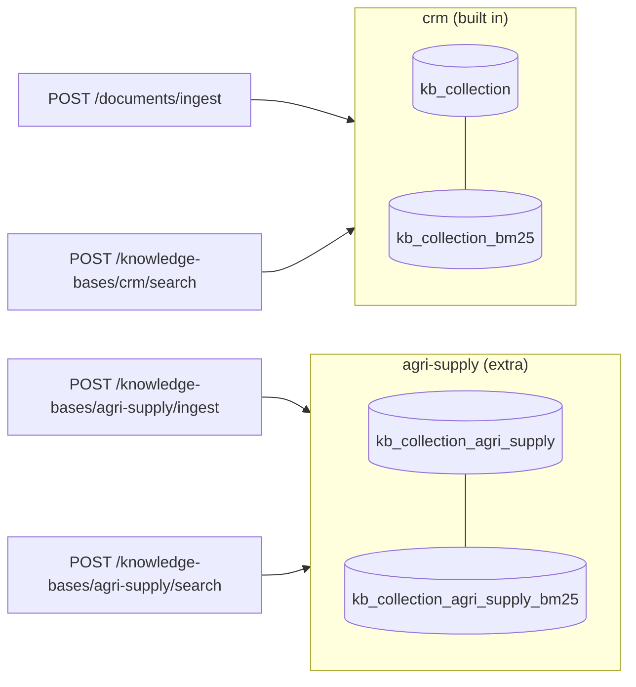
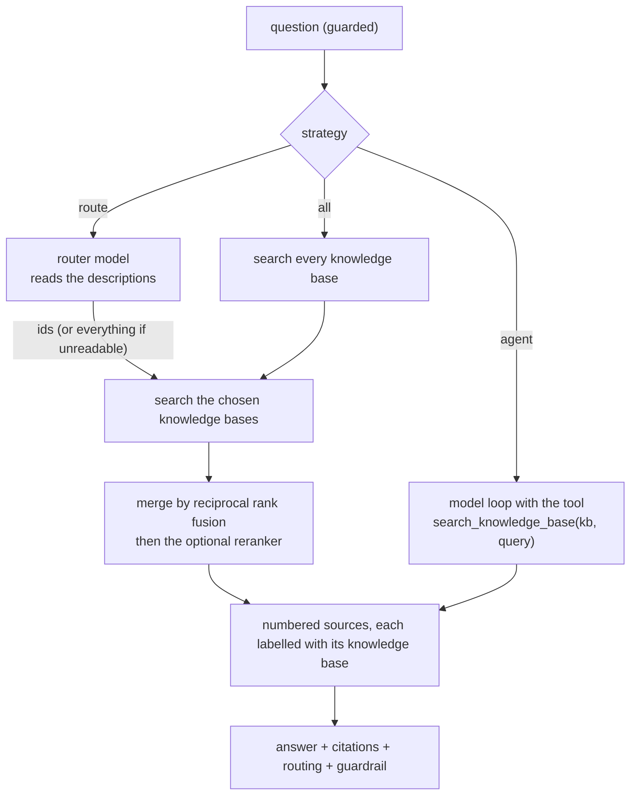

# Stage E1: multi-source RAG with routing (Java extension)

Not a port: the Java edition's own extension (see [java-extensions.md](../java-extensions.md)). Decisions: [ADR 0017](../adr/0017-knowledge-bases.md). Cut into slices: **E1.1** knowledge bases, **E1.2** routing strategies (below), E1.3 comparison. Decisions for E1.2: [ADR 0018](../adr/0018-multi-source-routing-strategies.md).

## E1.1: a second knowledge base

| Piece | File | Job |
| --- | --- | --- |
| The registry | `kb/KnowledgeBases.java`, `KnowledgeBase.java` | every knowledge base, each with its index, keyword index and retriever |
| Settings | `kb/KnowledgeBaseProperties.java`, `application.yml` | `id`, `label`, `description`, `source-dir` |
| Ingestion | `kb/KnowledgeBaseIngestion.java` | read, chunk, embed and store one extra knowledge base; never touches the others |
| Routes | `kb/KnowledgeBaseController.java` | list, ingest, search |
| The corpus | `sample-data/knowledge-bases/agri-supply/` | eight synthetic farm-supply documents |

### Concepts

1. **Multi-source is not multimodal.** Multimodal RAG is one index holding many kinds of content; multi-source RAG is several corpora and a decision about where to look.
2. **One collection per corpus.** Each corpus has its own lifecycle (ingest, wipe, re-embed) and isolation is structural: a search of one cannot see another.
3. **The description is data for the router.** Which corpus to search is decided from what each one says it contains, so the description is configuration written for that job.
4. **Reuse the retriever.** Hybrid search, the similarity floor and the reranker come with each knowledge base for free because they are properties of the retriever, not of the corpus.
5. **Scores are not comparable across corpora.** Another reason E1.2 merges by rank and may rerank.

## E1.2: three ways to decide where to search, `POST /api/v1/chat/multi`

| Piece | File | Job |
| --- | --- | --- |
| The route | `chat/MultiSourceChatController.java` | the three strategies, the tool loop, guard, citations |
| Router and merge | `kb/MultiSourceSearch.java` | read the router's JSON safely, search several knowledge bases, fuse and rerank |
| Chunk and its origin | `kb/KbChunk.java` | a retrieved chunk with its knowledge base |

### Concepts

1. **Routing is a decision under uncertainty.** A router can be wrong, so its failure mode matters: here an unreadable answer means "search everything", never "search nothing".
2. **Descriptions are the interface.** The router and the agent choose a knowledge base from its description; vague descriptions give bad routing.
3. **Merge by rank, not score.** Cosine scores from two corpora are not on one scale. Reciprocal rank fusion uses positions only; a reranker, which reads the question and the chunk together, does the real ordering.
4. **The model can be the router.** In `agent` mode the knowledge base is just a tool argument, so the model can search one corpus, read, and search another with a better query: more flexible, more calls.
5. **Cost shows up in different places.** `route` pays a model call before retrieval, `all` pays retrieval everywhere, `agent` pays a model call per round.
6. **Citations carry their origin.** Every source says which knowledge base it came from, so a reader can tell where an answer's evidence lives.
