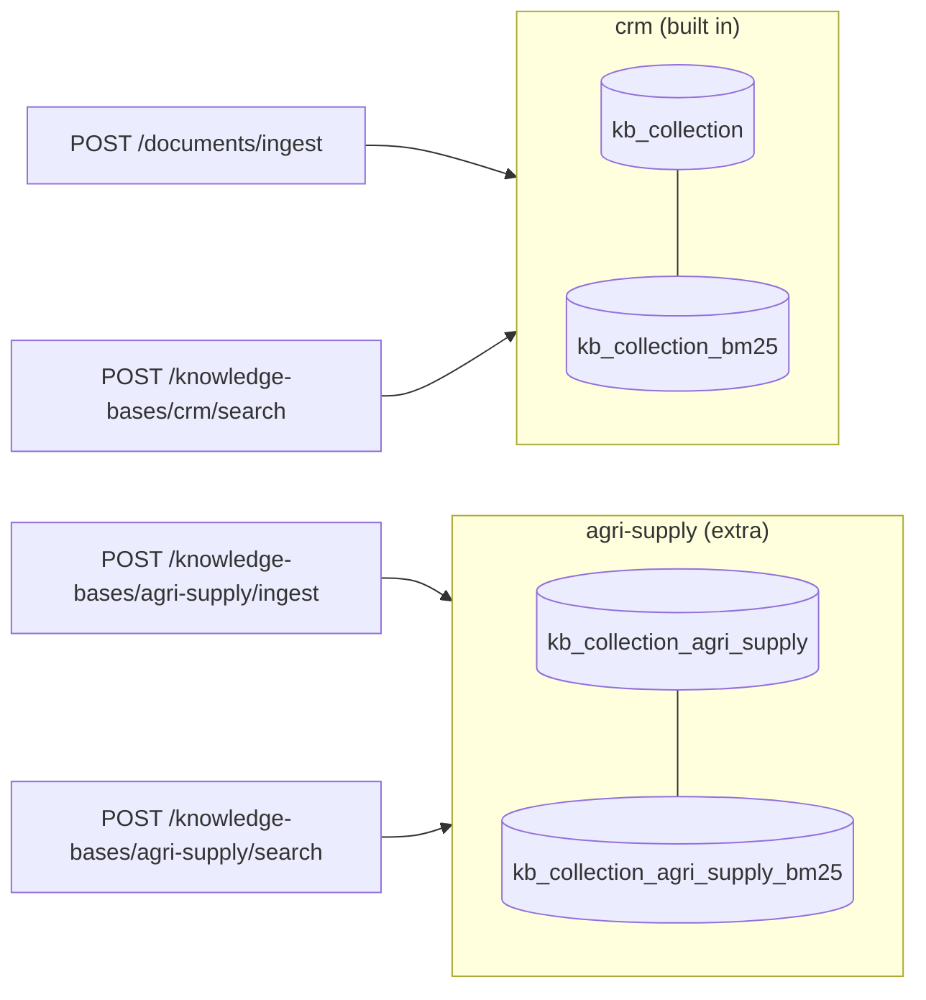

# Stage E1: multi-source RAG with routing (Java extension)

Not a port: the Java edition's own extension (see [java-extensions.md](../java-extensions.md)). Decisions: [ADR 0017](../adr/0017-knowledge-bases.md). Cut into slices: **E1.1** knowledge bases (this page), E1.2 routing strategies, E1.3 comparison.

## E1.1: a second knowledge base

| Piece | File | Job |
| --- | --- | --- |
| The registry | `kb/KnowledgeBases.java`, `KnowledgeBase.java` | every knowledge base, each with its index, keyword index and retriever |
| Settings | `kb/KnowledgeBaseProperties.java`, `application.yml` | `id`, `label`, `description`, `source-dir` |
| Ingestion | `kb/KnowledgeBaseIngestion.java` | read, chunk, embed and store one extra knowledge base; never touches the others |
| Routes | `kb/KnowledgeBaseController.java` | list, ingest, search |
| The corpus | `sample-data/knowledge-bases/agri-supply/` | eight synthetic farm-supply documents |

### Concepts

1. **Multi-source is not multimodal.** Multimodal RAG is one index holding many kinds of content; multi-source RAG is several corpora and a decision about where to look.
2. **One collection per corpus.** Each corpus has its own lifecycle (ingest, wipe, re-embed) and isolation is structural: a search of one cannot see another.
3. **The description is data for the router.** Which corpus to search is decided from what each one says it contains, so the description is configuration written for that job.
4. **Reuse the retriever.** Hybrid search, the similarity floor and the reranker come with each knowledge base for free because they are properties of the retriever, not of the corpus.
5. **Scores are not comparable across corpora.** Another reason E1.2 merges by rank and may rerank.
