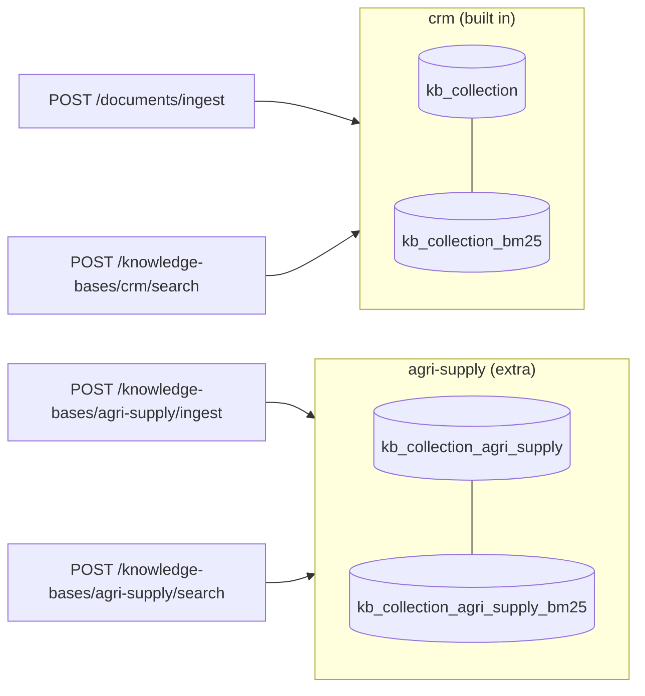
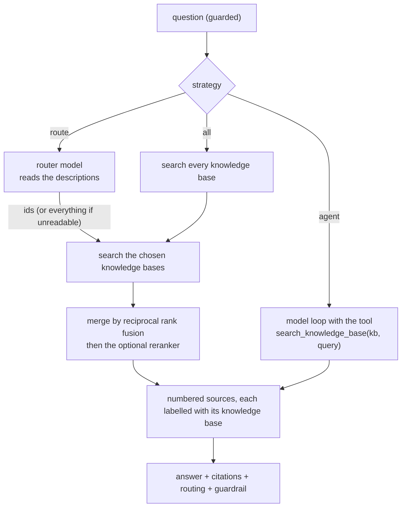
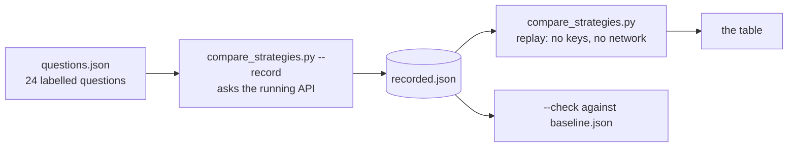
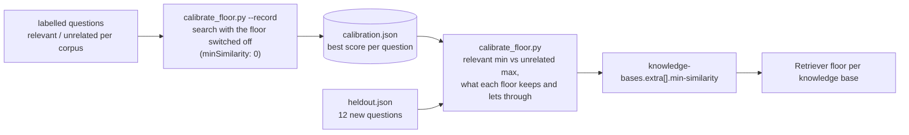

# Stage E1: multi-source RAG with routing (Java extension)

Not a port: the Java edition's own extension (see [java-extensions.md](../java-extensions.md)). Decisions: [ADR 0017](../adr/0017-knowledge-bases.md). Cut into slices: **E1.1** knowledge bases, **E1.2** routing strategies, **E1.3** a comparison, **E1.4** a similarity floor for each knowledge base (below). Decisions for E1.2: [ADR 0018](../adr/0018-multi-source-routing-strategies.md).

## E1.1: a second knowledge base

| Piece | File | Job |
| --- | --- | --- |
| The registry | `kb/KnowledgeBases.java`, `KnowledgeBase.java` | every knowledge base, each with its index, keyword index and retriever |
| Settings | `kb/KnowledgeBaseProperties.java`, `application.yml` | `id`, `label`, `description`, `source-dir` |
| Ingestion | `kb/KnowledgeBaseIngestion.java` | read, chunk, embed and store one extra knowledge base; never touches the others |
| Routes | `kb/KnowledgeBaseController.java` | list, ingest, search |
| The corpus | `sample-data/knowledge-bases/agri-supply/` | eight synthetic farm-supply documents |

### Concepts

1. **Multi-source is not multimodal.** Multimodal RAG is one index holding many kinds of content; multi-source RAG is several corpora and a decision about where to look.
2. **One collection per corpus.** Each corpus has its own lifecycle (ingest, wipe, re-embed) and isolation is structural: a search of one cannot see another.
3. **The description is data for the router.** Which corpus to search is decided from what each one says it contains, so the description is configuration written for that job.
4. **Reuse the retriever.** Hybrid search, the similarity floor and the reranker come with each knowledge base for free because they are properties of the retriever, not of the corpus.
5. **Scores are not comparable across corpora.** Another reason E1.2 merges by rank and may rerank.

## E1.2: three ways to decide where to search, `POST /api/v1/chat/multi`

| Piece | File | Job |
| --- | --- | --- |
| The route | `chat/MultiSourceChatController.java` | the three strategies, the tool loop, guard, citations |
| Router and merge | `kb/MultiSourceSearch.java` | read the router's JSON safely, search several knowledge bases, fuse and rerank |
| Chunk and its origin | `kb/KbChunk.java` | a retrieved chunk with its knowledge base |

### Concepts

1. **Routing is a decision under uncertainty.** A router can be wrong, so its failure mode matters: here an unreadable answer means "search everything", never "search nothing".
2. **Descriptions are the interface.** The router and the agent choose a knowledge base from its description; vague descriptions give bad routing.
3. **Merge by rank, not score.** Cosine scores from two corpora are not on one scale. Reciprocal rank fusion uses positions only; a reranker, which reads the question and the chunk together, does the real ordering.
4. **The model can be the router.** In `agent` mode the knowledge base is just a tool argument, so the model can search one corpus, read, and search another with a better query: more flexible, more calls.
5. **Cost shows up in different places.** `route` pays a model call before retrieval, `all` pays retrieval everywhere, `agent` pays a model call per round.
6. **Citations carry their origin.** Every source says which knowledge base it came from, so a reader can tell where an answer's evidence lives.

## E1.3: comparing the three strategies

24 labelled questions (8 CRM, 8 farm-supply, 4 that need both, 4 that belong to neither) asked of all three strategies with one small paid model and the default embedding model (`gemini-embedding-001`; a first recording on `gemini-embedding-2` ranked the strategies the same way). Decision and caveats: [ADR 0019](../adr/0019-multi-source-strategy-results.md).

| | route | all | agent |
| --- | --- | --- | --- |
| answerable questions: right sources found | 20/20 | 20/20 | 19/20 |
| of them, CRM-only questions | 8/8 | 8/8 | 8/8 |
| of them, farm-supply-only questions | 8/8 | 8/8 | 7/8 |
| of them, questions that need both | 4/4 | 4/4 | 4/4 |
| searched exactly the right knowledge bases (all questions) | 10/24 | 4/24 | 19/24 |
| searched at least the right ones | 24/24 | 24/24 | 23/24 |
| citations from the wrong knowledge base | 31/91 | 43/91 | 22/126 |
| no-corpus questions with no sources cited | 0/4 | 0/4 | 0/4 |
| model calls per question (mean) | 2 | 1 | 2.29 |
| median ms per question | 4228 | 3014 | 1388 |
| p95 ms per question | 7756 | 6865 | 3087 |
| failed requests | 0 | 0 | 0 |

| Piece | File | Job |
| --- | --- | --- |
| Questions | `evals/knowledge-bases/questions.json` | the question, the knowledge bases it belongs to, the documents that answer it |
| Recorder and replay | `evals/knowledge-bases/compare_strategies.py` | record answers (resumable, retries rate limits), replay them into a table, check against the baseline |
| Recorded answers | `evals/knowledge-bases/recorded.json` | the routing, the cited documents, model calls and latency of each of the 72 runs |
| Baseline | `evals/knowledge-bases/baseline.json` | the counts the check compares with |

### Concepts

1. **Measure the decision, not just the answer.** Each strategy is scored on which corpora it searched and which sources it found, so a wrong route shows up even when the answer happens to be fine.
2. **Labels are the contract.** A question's expected corpora and relevant documents are written down first; the harness only counts.
3. **A router is a classifier, and small models are weak classifiers.** Here the router mostly answered "everything", which is safe but gives no saving.
4. **Letting the model look, then look again** (the agent) beat deciding once, up front, at a similar number of model calls.
5. **A threshold belongs to its corpus.** The similarity floor of 0.45 was tuned on the CRM documents; against the farm-supply corpus unrelated questions scored 0.45 to 0.48, so nothing was filtered and the off-topic row is 0 of 4 for every strategy, on the default embedding model too.
6. **Replayable evidence.** Recording needs keys and takes minutes; replaying is instant and offline, so the table in the guide can be checked by anyone.

## E1.4: a similarity floor for each knowledge base

Decisions and numbers: [ADR 0023](../adr/0023-per-corpus-similarity-floor.md). E1.3 found that the global 0.45 floor, tuned on the CRM documents, lets unrelated questions through the farm-supply handbook (they score 0.45 to 0.48). Each knowledge base can now set its own floor, calibrated on its corpus.

| Piece | File | Job |
| --- | --- | --- |
| The floor | `rag/Retriever.java` (`floor`, `retrieve(..., minSimilarity)`) | one floor per retriever; the global one when none is set |
| Settings | `rag/RetrievalProperties.java`, `kb/KnowledgeBaseProperties.java`, `application.yml` | `retrieval.min-similarity`, `knowledge-bases.extra[].min-similarity` |
| Registry | `kb/KnowledgeBases.java` | gives each knowledge base's retriever its floor; refuses a value outside 0 to 1 |
| Routes | `kb/KnowledgeBaseController.java` | `similarityFloor` in the list and the search; `minSimilarity` override for calibration |
| Calibration | `evals/knowledge-bases/calibrate_floor.py`, `calibration.json`, `heldout.json`, `calibration-heldout.json` | record the scores, show the gap, check on new questions |

### Concepts

1. **A threshold belongs to a corpus (and an embedding model).** The same number means different things against different documents, and it has to be calibrated, not inherited.
2. **Calibrate from both sides.** A floor is a gap between the best relevant score and the best unrelated one; the tool shows both, and what each candidate floor keeps and lets through.
3. **In-sample is not evidence.** Floors tuned on the questions they are scored on look perfect; twelve held-out questions showed one relevant question lost.
4. **Scores can genuinely overlap.** Here one relevant and one unrelated question both score about 0.62; no floor separates them, and the choice is a trade between recall and noise.
5. **A floor cannot repair a routing mistake.** The two questions lost with calibrated floors were routing choices (the wrong single corpus, or one corpus when both were needed); a stricter floor removes noise, not routing errors.
6. **Fewer weak sources, fewer model calls.** With nothing retrieved the answering model is not called.

