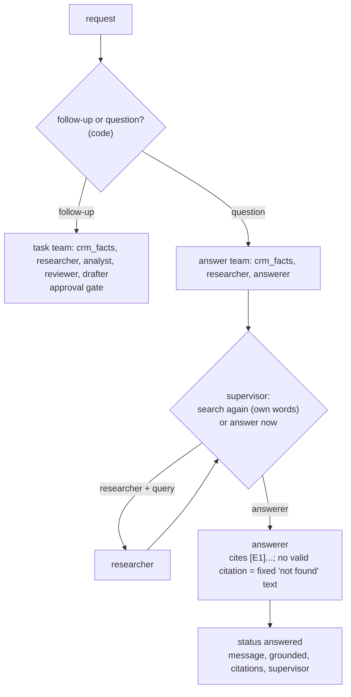
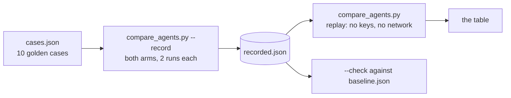

# Stage E3: a supervisor with specialist agents (Java extension)

Not a port: the Java edition's own extension (see [java-extensions.md](../java-extensions.md)). Decisions: [ADR 0020](../adr/0020-supervisor-with-specialist-agents.md). Cut into slices: **E3.1** the supervisor graph (this page), **E3.2** an answer team and supervisor-written queries (below), **E3.3** a comparison with the fixed pipeline (below).

## E3.1: `POST /api/v1/agent/supervise`

| Piece | File | Job |
| --- | --- | --- |
| The graph, the rules, the specialists | `agent/SupervisorWorkflow.java` | supervisor node, allowed lists, the five specialists |
| The route | `agent/SupervisorController.java` | `POST /agent/supervise`, same request and errors as `/agent/recommend` |
| The settings | `agent/SupervisorProperties.java` | `supervisor.max-turns` |
| Reused | `agent/AgentWorkflow.java` nodes, `Agents`, `ApprovalGate` | the specialists' work, the guard, the pause |

### What the supervisor may do

Each turn code builds the list of **allowed** specialists; the model chooses from it only when there is more than one.

| State | Allowed |
| --- | --- |
| customer not loaded | `crm_facts` |
| no customer found | `FINISH` |
| no recommendation yet | `analyst`, and `researcher` (at most twice) |
| a recommendation, not reviewed | `reviewer` |
| reviewed and approved, or out of revisions | `drafter` |
| reviewed and sent back, revisions left | `analyst`, and `researcher` |
| note written | `FINISH` |

An unreadable or disallowed answer is replaced by the first allowed entry (the fixed pipeline's next step) and recorded with the reason.

### Concepts

1. **Pipeline versus supervisor.** A pipeline has the order in code; a supervisor has the order in a model's turn-by-turn decisions. The supervisor is more flexible and costs more.
2. **A model coordinating models needs rails.** The supervisor is itself a model, so preconditions, caps and limits are code, and a bad answer degrades to the pipeline instead of derailing the run.
3. **Hand control back.** Every specialist returns to the supervisor, so the supervisor sees the new state before choosing again.
4. **Do not ask when there is no choice.** One allowed specialist means no model call: the cheapest, safest decision is the one code can make.
5. **Specialists are reusable.** Four of the five are the fixed pipeline's own nodes; the fifth (the researcher) uses the multi-source search of E1. Adding a specialist is adding a node, a precondition and a line in the prompt.
6. **Decisions are data.** The response lists every turn: who chose (`supervisor` or `code`), why, what was allowed, and what the model proposed when it was overridden.
7. **The human gate stays.** However the work was coordinated, nothing is written until `POST /agent/confirm` with a yes.

## E3.2: an answer team and the supervisor's own search words

Decisions: [ADR 0021](../adr/0021-answer-team-and-supervisor-queries.md). The same route, `POST /api/v1/agent/supervise`, now handles two kinds of request; code decides which team runs (the rule that already separated a follow-up from a simple question).

| State of a question | Allowed |
| --- | --- |
| customer not loaded | `crm_facts` |
| no research yet | `researcher` (one choice: no model call) |
| researched | `answerer`, and `researcher` once more (a real choice: the supervisor is asked) |
| answered | `FINISH` |

### Concepts

1. **Route to a team, not only to a step.** The supervisor coordinates different sets of specialists depending on the kind of work. Here the team is chosen in code, because the approval gate must never depend on a model's mood.
2. **A decision with content.** The supervisor does not only pick a name: it can write the words the researcher searches for. Model-written text is still untrusted input: trimmed, capped and only honoured for the researcher.
3. **Fail closed on grounding.** An answer is shown only if it cites evidence that exists; otherwise the fixed "could not find" text is shown and `grounded` is false.
4. **No customer is fine for a question** and not for a follow-up: the same specialist, different rules per team.
5. **Decisions stay visible.** `supervisor.turns` records who chose each step, why, and the search words.
6. **What was left out.** Parallel specialists need a state merge for the evidence list; with such short specialists it would only buy latency.

## E3.3: the supervisor against the fixed pipeline

The same ten golden cases, twice each, through `POST /agent/recommend` (the pipeline) and `POST /agent/supervise` (the supervisor), one small paid model, default embeddings. Decision and caveats: [ADR 0022](../adr/0022-supervisor-versus-pipeline-results.md).

| | pipeline | supervisor |
| --- | --- | --- |
| runs as expected (status and company) | 20/20 | 20/20 |
| analyses completed | 14 | 14 |
| completed with valid citations | 14/14 | 14/14 |
| completed and approved by the reviewer | 11/14 | 13/14 |
| evidence items per completed run | 7.3 | 7.4 |
| farm-supply items shown to the analyst (completed) | 0 | 24 |
| model calls per completed run | 3.57 | 5.14 |
| model calls in total | 50 | 76 |
| tasks written before a confirm (must be 0) | 0 | 0 |
| runs flagged by the guard | 0 | 0 |
| median ms per run | 6725 | 9057 |
| p95 ms per run | 14812 | 18727 |
| failed requests | 0 | 0 |

| Piece | File | Job |
| --- | --- | --- |
| Cases | `evals/supervisor/cases.json` | the message, and the expected status for each arm |
| Recorder and replay | `evals/supervisor/compare_agents.py` | run both arms (resumable), check that no task was written, replay into a table, compare with the baseline |
| Recorded runs | `evals/supervisor/recorded.json` | status, company, citations, model calls, latency and the supervisor's decisions for each of the 40 runs |
| Baseline | `evals/supervisor/baseline.json` | the counts the check compares with |

### Concepts

1. **Measure the cost of flexibility.** A supervisor can only be judged against a baseline that already works; the fixed pipeline is that baseline.
2. **Rails make a weak model usable.** Every one of the supervisor's 26 decisions was readable and allowed, because the choices were short lists and code made the rest.
3. **A feature that is never exercised is not measured.** The cases here suit the pipeline; a supervisor's value shows on cases the pipeline cannot do.
4. **Freedom has a footprint.** The researcher fetched farm-supply chunks for CRM-only questions: harmless to the citation check, noise for the analyst.
5. **Cost is calls and seconds.** About 40% more model calls and a third more time for the same quality on these cases.

