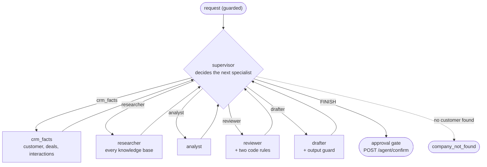

# Stage E3: a supervisor with specialist agents (Java extension)

Not a port: the Java edition's own extension (see [java-extensions.md](../java-extensions.md)). Decisions: [ADR 0020](../adr/0020-supervisor-with-specialist-agents.md). Cut into slices: **E3.1** the supervisor graph (this page), E3.2 more autonomy, E3.3 a comparison with the fixed pipeline.

## E3.1: `POST /api/v1/agent/supervise`

| Piece | File | Job |
| --- | --- | --- |
| The graph, the rules, the specialists | `agent/SupervisorWorkflow.java` | supervisor node, allowed lists, the five specialists |
| The route | `agent/SupervisorController.java` | `POST /agent/supervise`, same request and errors as `/agent/recommend` |
| The settings | `agent/SupervisorProperties.java` | `supervisor.max-turns` |
| Reused | `agent/AgentWorkflow.java` nodes, `Agents`, `ApprovalGate` | the specialists' work, the guard, the pause |

### What the supervisor may do

Each turn code builds the list of **allowed** specialists; the model chooses from it only when there is more than one.

| State | Allowed |
| --- | --- |
| customer not loaded | `crm_facts` |
| no customer found | `FINISH` |
| no recommendation yet | `analyst`, and `researcher` (at most twice) |
| a recommendation, not reviewed | `reviewer` |
| reviewed and approved, or out of revisions | `drafter` |
| reviewed and sent back, revisions left | `analyst`, and `researcher` |
| note written | `FINISH` |

An unreadable or disallowed answer is replaced by the first allowed entry (the fixed pipeline's next step) and recorded with the reason.

### Concepts

1. **Pipeline versus supervisor.** A pipeline has the order in code; a supervisor has the order in a model's turn-by-turn decisions. The supervisor is more flexible and costs more.
2. **A model coordinating models needs rails.** The supervisor is itself a model, so preconditions, caps and limits are code, and a bad answer degrades to the pipeline instead of derailing the run.
3. **Hand control back.** Every specialist returns to the supervisor, so the supervisor sees the new state before choosing again.
4. **Do not ask when there is no choice.** One allowed specialist means no model call: the cheapest, safest decision is the one code can make.
5. **Specialists are reusable.** Four of the five are the fixed pipeline's own nodes; the fifth (the researcher) uses the multi-source search of E1. Adding a specialist is adding a node, a precondition and a line in the prompt.
6. **Decisions are data.** The response lists every turn: who chose (`supervisor` or `code`), why, what was allowed, and what the model proposed when it was overridden.
7. **The human gate stays.** However the work was coordinated, nothing is written until `POST /agent/confirm` with a yes.
