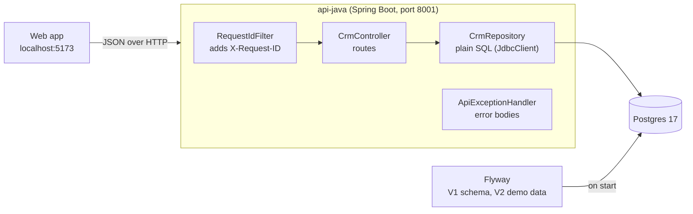

# Stage J1: a Spring Boot skeleton and the CRM API

Ports the Python edition's V2 base: `GET /health`, `/api/v1/companies`, `/api/v1/companies/{id}`, `/api/v1/tasks`, the error shapes and the request id. Decisions: [ADR 0002](../adr/0002-crm-api-data-access.md).

## What runs, in one picture

## Concept 1. The layers of the app

| Piece | File | Job | Python edition twin |
| --- | --- | --- | --- |
| Entry point | `Application.java` | Starts Spring Boot, which finds the other pieces by annotation | `app/main.py` |
| Controller | `crm/CrmController.java` | Maps a URL to a method and returns an object that becomes JSON | `app/routes/companies.py`, `tasks.py` |
| Repository | `crm/CrmRepository.java` | The SQL, one method per question | the queries inside the routes |
| Records | `crm/Records.java` | The JSON shapes (field names snake_case on purpose) | the dicts the routes return |
| Error handler | `web/ApiExceptionHandler.java` | One place that turns any exception into the shared body | `http_exception_handler` in `main.py` |
| Request id | `web/RequestIdFilter.java` | Keeps or creates `X-Request-ID` for every response | `app/middleware.py` |
| Config | `application.yml` | Database address, port, CORS origin (all overridable by environment variables) | `app/config.py` |

## Concept 2. Flyway: the schema as numbered files

On start, Flyway looks in `db/migration` for files named `V<number>__<name>.sql`, runs the ones not yet applied, and records them in a table (`flyway_schema_history`). Change an applied file and Flyway refuses to start (it checks a checksum), so history cannot be rewritten by accident. This is the same idea as Alembic's revisions in the Python edition.

## Concept 3. Why plain SQL and not an ORM here

A read route is one query and one mapping. Writing the SQL shows exactly what the database is asked, and it is the same text as in the Python edition, so the two can be compared line by line. An ORM earns its keep with writes, relations and change tracking; the routes here have none of that yet.

## Concept 4. The contract check

`contracts/http/crm_contract.py` is a short script that calls the routes and checks the answers: counts, field names, sorting, money as `"48000.00"`, times ending `+00:00`, error bodies and the request id. It takes a base URL, so the same file is run against the Python and the Java API. When both pass, a web app written once works with either.

## Concept 5. Testcontainers

The JUnit tests start a real `postgres:17.11` in Docker for the test run, point the app at it, and call the routes over HTTP. No fake database, so the SQL and the migrations are really tested. The cost is that Docker must be running.

## Questions to answer in your own words

1. What does Flyway do when it starts, and what happens if you edit `V1__baseline_schema.sql` after it ran?
2. Why is `amount` a string in the JSON and not a number?
3. Why do the timestamps end in `+00:00` and not `Z`?
4. The Java API answers `/api/v1/zzz` with only a `detail` key. Why, and where should the fix be made?
5. What would you lose by testing against an in-memory fake database instead of Testcontainers?
6. Why does the Java API use port 8001 and not another?

## Code tour

1. `Application.java`, then `CrmController.java`, then `CrmRepository.java`.
2. `src/main/resources/db/migration/V1__baseline_schema.sql` next to `apps/api-py/migrations/versions/0001_baseline_schema.py`.
3. `ApiExceptionHandler.java`, with the comment about the two copied gaps.
4. `CrmApiTests.java`: read the test names, they are the checks in sentences.
