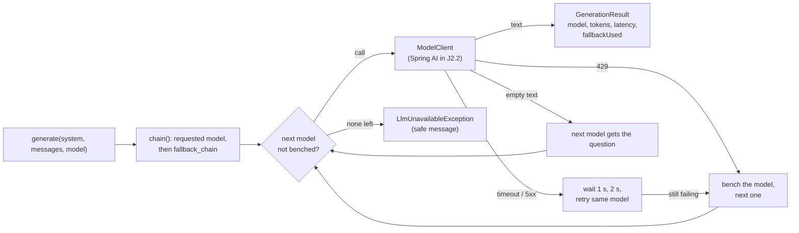

# Stage J2: the model layer

Ports Python Stage 1 (settings, model catalogue, gateway) and, in J2.2, the chat route. Decisions: [ADR 0003](../adr/0003-model-gateway.md).

## J2.1: gateway and model list

| Piece | File | Job | Python twin |
| --- | --- | --- | --- |
| Catalogue | `llm/ModelCatalogLoader.java`, `models.yaml` | default model, fallback chain, saved dropdown list (same file) | `app/config.py`, `models.yaml` |
| Settings | `llm/LlmProperties.java`, `application.yml` | timeout, retries, wait, cool-down, key | `app/config.py` |
| Gateway | `llm/ModelGateway.java` | the whole policy, in one loop | `app/llm/gateway.py` |
| One call | `llm/ModelClient.java` | the seam; the real client comes in J2.2 | LiteLLM `acompletion` |
| Model list | `llm/LlmController.java` | `GET /api/v1/llm/models`: live list, five-minute cache, saved list on failure | `app/routes/llm.py` |

### Concepts

1. **A policy you can read.** The retry and fallback rules are a loop, not configuration of a library. Read `callChain` top to bottom and you have the rules.
2. **Failure kinds.** A 429 and a timeout are different problems. Retrying a rate-limited free model at once is pointless; a timeout may pass. The gateway tells them apart by the `Kind` of the exception.
3. **Cool-down.** After a failure the model is skipped for 30 s so the next requests do not hammer it. State lives in the gateway (per process).
4. **Empty is a failure.** Thinking models can spend every allowed token on reasoning and return no text. That is an attempt that failed, not a blank answer for the user.
5. **Seams.** A `Clock` and a `Sleeper` are passed in, so a test can move time and record waits without sleeping.

### Questions

1. Why is a 429 not retried on the same model, but a 503 is?
2. What does a user see when every model in the chain fails? What is deliberately left out of that message?
3. A request names a model that is not in `fallback_chain`. What is the chain?
4. After a 429 from model A, a second request arrives 10 s later. Which models are called? And 40 s later?
5. Why does the gateway not know about HTTP or Spring AI?

### Code tour

`ModelGateway.java` (`generate`, then `callChain`), then `ModelGatewayTests.java` (read the names), then `LlmController.java`.
