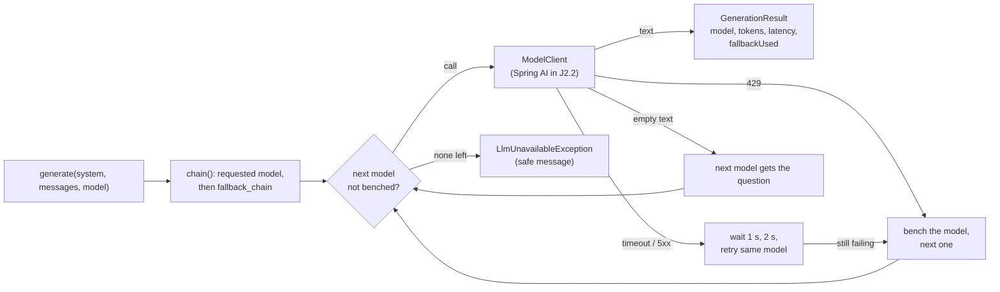
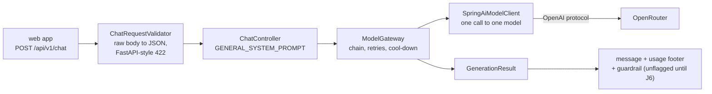

# Stage J2: the model layer

Ports Python Stage 1 (settings, model catalogue, gateway) and, in J2.2, the Spring AI client and the chat route. Decisions: [ADR 0003](../adr/0003-model-gateway.md).

## J2.1: gateway and model list

| Piece | File | Job | Python twin |
| --- | --- | --- | --- |
| Catalogue | `llm/ModelCatalogLoader.java`, `models.yaml` | default model, fallback chain, saved dropdown list (same file) | `app/config.py`, `models.yaml` |
| Settings | `llm/LlmProperties.java`, `application.yml` | timeout, retries, wait, cool-down, key | `app/config.py` |
| Gateway | `llm/ModelGateway.java` | the whole policy, in one loop | `app/llm/gateway.py` |
| One call | `llm/ModelClient.java` | the seam; the real client comes in J2.2 | LiteLLM `acompletion` |
| Model list | `llm/LlmController.java` | `GET /api/v1/llm/models`: live list, five-minute cache, saved list on failure | `app/routes/llm.py` |

### Concepts

1. **A policy you can read.** The retry and fallback rules are a loop, not configuration of a library. Read `callChain` top to bottom and you have the rules.
2. **Failure kinds.** A 429 and a timeout are different problems. Retrying a rate-limited free model at once is pointless; a timeout may pass. The gateway tells them apart by the `Kind` of the exception.
3. **Cool-down.** After a failure the model is skipped for 30 s so the next requests do not hammer it. State lives in the gateway (per process).
4. **Empty is a failure.** Thinking models can spend every allowed token on reasoning and return no text. That is an attempt that failed, not a blank answer for the user.
5. **Seams.** A `Clock` and a `Sleeper` are passed in, so a test can move time and record waits without sleeping.

### Questions

1. Why is a 429 not retried on the same model, but a 503 is?
2. What does a user see when every model in the chain fails? What is deliberately left out of that message?
3. A request names a model that is not in `fallback_chain`. What is the chain?
4. After a 429 from model A, a second request arrives 10 s later. Which models are called? And 40 s later?
5. Why does the gateway not know about HTTP or Spring AI?

### Code tour

`ModelGateway.java` (`generate`, then `callChain`), then `ModelGatewayTests.java` (read the names), then `LlmController.java`.

## J2.2: Spring AI client and `POST /api/v1/chat`

| Piece | File | Job | Python twin |
| --- | --- | --- | --- |
| Client | `llm/SpringAiModelClient.java` | one Spring AI call, failures sorted into kinds | LiteLLM `acompletion` |
| Wiring | `llm/LlmBeans.java` | the client bean (replaces the J2.1 placeholder) | n/a |
| Route | `chat/ChatController.java` | `POST /api/v1/chat`: validate, call the gateway, add the usage footer | `general_chat` in `routes/chat.py` |
| Validation | `chat/ChatRequestValidator.java` | 1 to 12 messages, role, 4,000 characters, FastAPI's 422 bodies | `ChatRequest` (Pydantic) |

### Concepts

1. **Spring AI as a thin client.** The framework makes one HTTP call and parses the reply. It does not decide what happens when a model is rate-limited: that is the gateway, written out in plain Java (ADR 0003).
2. **Do not let a library retry behind your back.** The SDK retries by default; with it on, a 429 would be retried on the same model and the "next model at once" rule would silently stop being true.
3. **Classify errors by type.** A failure becomes a `RateLimit`, `Timeout`, `ServerError` and so on because of the exception class and status code, never by searching a message.
4. **A body the framework cannot read still gets the shared answer.** The route takes the raw body, so an empty body, non-JSON text and a wrong content type give the same 422 that FastAPI gives, not a framework 500.
5. **A stub that says so.** The `guardrail` field is always `{"flagged": false, "reasons": []}` until J6 adds the prompt and output guards. The field exists now so the web app and the contract do not change later.

### Questions

1. Why is only `spring-ai-openai` on the classpath and not the Spring AI starter?
2. What would go wrong if the SDK's retries were on?
3. A user sends 13 messages. Which status and body come back, and who decides?
4. The key is rejected by OpenRouter (HTTP 401). What does the user see, and what must the message not contain?
5. Why does the gateway not know that Spring AI exists?

### Code tour

`SpringAiModelClient.java` (`complete`, then `translate`), `SpringAiModelClientTests.java` (a fake OpenRouter on a local port), then `ChatRequestValidator.java` and `ChatControllerTests.java` (the 422 bodies are the exact ones the Python edition returns).

