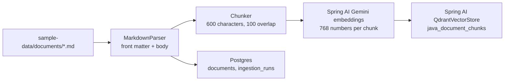
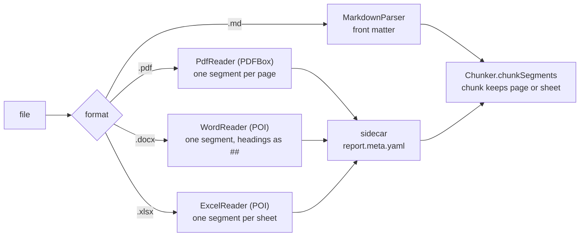

# Stage J3: documents and RAG

Ports Python Stage 4 (ingestion, retrieval, `/chat/rag`, `/chat/crm`). Decisions: [ADR 0004](../adr/0004-documents-and-vector-store.md). Cut into slices: **J3.1** ingestion of Markdown (this page), J3.2 PDF, Word and Excel with page and sheet in citations, J3.3 retrieval and `POST /chat/rag`, J3.4 `POST /chat/crm`.

## J3.1: ingest Markdown documents

| Piece | File | Job | Python twin |
| --- | --- | --- | --- |
| Chunking | `rag/Chunker.java` | overlapping windows of characters | `rag/chunking.py` |
| Reading | `rag/MarkdownParser.java` | front matter (title, type, company) and body | `rag/parse.py` |
| Index | `rag/VectorIndex.java` | Gemini embeddings plus the Qdrant collection, built on first use | `rag/embeddings.py`, `rag/qdrant_store.py` |
| Pipeline | `rag/DocumentIngestionService.java` | read, chunk, embed, store, record the run | `rag/ingest.py` |
| Routes | `rag/DocumentController.java` | `POST /documents/ingest`, `GET /documents`, `GET /documents/ingestion-runs` | `routes/documents.py` |

### Concepts

1. **Chunking is a policy, not a detail.** Too big and the embedding blurs several topics; too small and the answer is cut in half. The overlap keeps a sentence that straddles a boundary whole in one chunk.
2. **Ingestion is a separate, re-runnable step.** It clears and rebuilds, so running it twice never duplicates; chat only reads.
3. **A payload that can be cited without a join.** Every chunk carries its document id, title, path, type and company, so a result can be shown with its source straight from Qdrant.
4. **Postgres is the record, Qdrant is the index.** Documents and run history live in Postgres; vectors and the citable payload live in Qdrant.
5. **Use the framework, then test where it lies.** Two surprises (the reported vector length and `Long` stored as text) only appeared against the real services (ADR 0004).

### Questions

1. Why is the overlap 100 and not 0? What would a question about a sentence at a boundary do without it?
2. Re-running ingestion: what is cleared, and in what order? What happens to the history of runs?
3. Why is `document_id` an `int` in the payload and not a `long`?
4. The Gemini model is asked for 768 numbers. Why did the collection first come out as 3072, and where is that fixed?
5. A Markdown file has no `type`. What does the caller see, and which file is named?

### Code tour

`Chunker.java`, then `ChunkerTests.java` (the last test compares with the Python edition's chunk counts), then `DocumentIngestionService.java` and `DocumentIngestionTests.java` (a real Postgres and a real Qdrant in containers, with a fake embedding model).

## J3.2: PDF, Word and Excel, with the page or sheet in the citation

| Piece | File | Job | Python twin |
| --- | --- | --- | --- |
| Dispatch | `rag/DocumentReader.java` | picks the reader, skips `.meta.yaml` sidecars | `parse_file`, `is_document` |
| Sidecar | `rag/DocumentMetadata.java` | title, type, company for the non-Markdown formats | `read_sidecar`, `_check` |
| PDF | `rag/PdfReader.java` | one segment per page with text | `parse_pdf_pages` |
| Word | `rag/WordReader.java` | one segment of Markdown-like text | `parse_word` |
| Excel | `rag/ExcelReader.java`, `rag/MarkdownTable.java` | one segment per sheet, the table laid out as Python lays it out | `parse_sheets` |

### Concepts

1. **A citation says where.** "Clause 7.3, page 2" or "Fleet Plus, sheet Rate card" is worth more than a file name. So the reader keeps a location with each run of text and every chunk inherits it.
2. **Equal text, not just equal meaning.** Both editions embed the text of the same files; if the Java reader wrote the table differently, the vectors would differ and the same question could cite a different chunk. The tests compare the text character for character.
3. **No library to copy, so copy the output.** Docling has no Java twin; the Java readers reproduce its output shape (headings, table layout) and the test says whether they got it right.
4. **Metadata beside the file.** Only Markdown can carry its own metadata. A sidecar keeps the rule simple and the error message exact.

### Questions

1. Why is a PDF split into one segment per page instead of one segment for the whole file?
2. A chunk from page 2 starts at character 0 of its chunk. Relative to what are `char_start` and `char_end`?
3. The Excel table has a column of prices. Which alignment does it get, and why does the width not equal the longest number?
4. A PDF is added with no `.meta.yaml`. What does the caller see?
5. What can a spreadsheet hold that this reader does not tell apart?

### Code tour

`DocumentReader.java`, then `ExcelReader.java` and `MarkdownTable.java`, then `DocumentReaderTests.java` (the expected text in the tests is the Python edition's own output for the same files).

