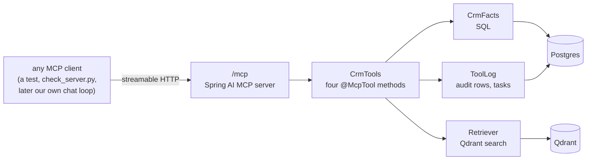
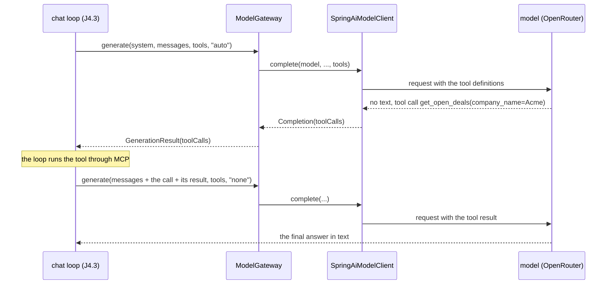

# Stage J4: tools and MCP

Ports Python Stage 2 (native tool calling, MCP tool servers, `/chat/tools`, `/mcp/servers`). Decisions: [ADR 0008](../adr/0008-mcp-tool-server-inside-the-api.md). Cut into slices: **J4.1** the tool server, **J4.2** tool calling in the model layer, J4.3 `POST /chat/tools`, `GET /mcp/servers`, the audit log route and the confirm rule.

## J4.1: the MCP tool server, inside the API

| Piece | File | Job | Python twin |
| --- | --- | --- | --- |
| Tools | `mcp/CrmTools.java` | the four tools, as `@McpTool` methods | `app/mcp/tools.py`, `server.py` |
| Writes | `mcp/ToolLog.java` | audit rows and the one write (a task) | `_log_tool_call` |
| Company match | `crm/CompanySummary.CompanyRef.findMentioned` | "Acme" finds "Acme Fabrication" | `find_mentioned_company` |
| Settings | `application.yml` (`spring.ai.mcp.server`) | the endpoint and the server name | `app/mcp/server.py` |
| Contract | `contracts/mcp-tools.json`, `contracts/check_server.py` | the one description both editions follow | the same files |

### Concepts

1. **A tool is a described function.** A method marked `@McpTool` with described parameters is all Spring AI needs: it builds the tool list and the JSON Schema a model reads, and routes a call to the method.
2. **MCP is a protocol, not a library.** Any client that speaks it (our own tests, the Python checker, a desktop app) can list and call these tools without knowing anything about Java.
3. **A contract file settles "equivalent".** Two servers in two languages are interchangeable when the same file says what they offer and a checker runs every case against both. Here the checker was written for the Python servers and passes unchanged.
4. **The argument name is the parameter name.** Spring AI cannot rename a tool argument, so the Java parameters are `company_name`, not `companyName`, exactly as the contract says.
5. **A read tool and a write tool are different animals.** Reading is audited and returns facts. The write only proposes unless it is told to confirm, and the one that tells it is the chat route, from the user's own words, never the model.
6. **Untrusted text stays untrusted.** `search_documents` returns document text as it is; whoever puts it in front of a model must wrap it as data (J4.3).

### Questions

1. Why is the tool server inside the API and not a second application? What would make you move it out?
2. The contract says `company_name`. What would happen if the Java parameter were called `companyName`?
3. `create_followup_task` is called without `confirm`. What is returned, what is written to the database, and what is written to the audit log?
4. "Acme" and "Acme Fabrication" both find the company. Which rule does that, and where else is it used?
5. Qdrant is stopped and the model asks for `search_documents`. What does it get back, and why is that better than a generic error?

### Code tour

`CrmTools.java`, then `McpToolsTests.java` (a real MCP client, the contract file, a real Postgres), then `ToolLog.java`. To see the same server from outside: `just mcp-contract` and `just mcp-call get_open_deals '{"company_name": "Acme"}'`.

## J4.2: tool calling in the model layer

| Piece | File | Job | Python twin |
| --- | --- | --- | --- |
| Tool types | `llm/ToolDefinition.java`, `llm/ToolCall.java` | what is offered, what the model asked for | `ToolCall` in `llm/types.py` |
| Messages | `llm/ChatMessage.java` | an assistant turn with tool calls, a tool result | the OpenAI message shapes |
| Gateway | `llm/ModelGateway.java` | tools through the chain; a tool call is a valid answer; raw markup is a failed attempt | `generate(..., tools=)`, `_is_raw_tool_markup` |
| Client | `llm/SpringAiModelClient.java` | send the definitions, read the calls, never run a tool | LiteLLM `acompletion` |

### Concepts

1. **The model asks, the program acts.** A model never runs anything. It returns "call this tool with these arguments" and the program decides whether and how to run it. That is why the confirm rule can live in code.
2. **A reply is text, tool calls, or both.** An empty text with a tool call is a normal answer; an empty text with nothing else is a failure. The gateway's definition of "failed attempt" changed for this reason.
3. **Arguments are untrusted JSON.** A model can send malformed arguments. The call carries an `error` instead of throwing, so the loop can tell the model and let it try again.
4. **`auto` and `none`.** `auto` lets the model choose between answering and calling a tool; `none` forces text, which is how the loop gets a final answer after its call limit.
5. **Small models fake it.** Some print tool-call markup as plain text. The gateway recognises that and moves to the next model.
6. **A framework can be thinner than you expect.** In this Spring AI version the chat model only sends and receives; running tools is somebody else's job. Reading the library's own classes settled that, not its documentation.

### Questions

1. A model answers with an empty text and one tool call. Is that a failed attempt? What if it answers with an empty text and no tool call?
2. The model sends `"arguments": "not json"`. What does the loop receive, and why is that better than an exception?
3. What does tool choice `none` do, and when is it used?
4. A model prints `<|tool_call_start|>[search(...)]` as text. What does the gateway do, and what does the user see if every model does it?
5. Why are the gateway and its tests written in our own types and not in Spring AI's?

### Code tour

`ModelClient.java` (the two calls), `SpringAiModelClient.java` (`complete` with tools, then `readToolCalls`), `ModelGateway.java` (`generate` and the success rule), then `SpringAiModelClientTests.java` (the fake provider shows exactly what is sent) and `ModelGatewayTests.java` (the last block).

