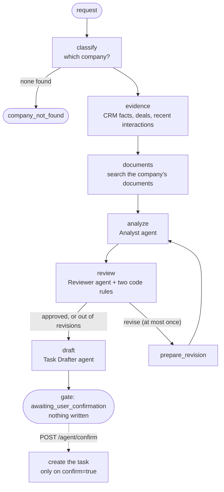
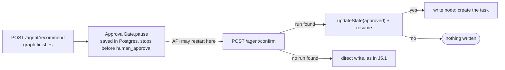

# Stage J5: the agent

Ports Python Stage 3 (the account follow-up agent as a graph, with a human approval and a durable pause). Decisions: [ADR 0011](../adr/0011-agent-graph-on-langgraph4j.md). Cut into slices: **J5.1** the graph and the two routes (this page), **J5.2** the durable pause (a Postgres saver, so a paused run survives an API restart; below). Decisions for J5.2: [ADR 0012](../adr/0012-durable-pause-postgres-saver.md).

## J5.1: the agent graph, `POST /agent/recommend` and `POST /agent/confirm`

| Piece | File | Job | Python twin |
| --- | --- | --- | --- |
| Graph and nodes | `agent/AgentWorkflow.java` | the nodes, the edges, the limits, the response | `agent/workflow.py` |
| Agents | `agent/Agents.java` | three prompts, three safe JSON parsers, the grounding check | `agent/agents.py` |
| Limits | `agent/RunBudget.java`, `AgentProperties.java` | steps, time, revisions | `agent/policies.py` |
| Routing | `agent/AgentIntent.java` | does a message need the agent at all | `needs_agent` |
| Trace | `agent/Trace.java` | an ordered, inspectable record of every step | `agent/trace.py` |
| Routes | `agent/AgentController.java`, `agent/AgentRequests.java` | the two endpoints, FastAPI-style 422s | `routes/agent.py` |

### Concepts

1. **Code decides the order, the model does one job.** Each agent is one model call with one JSON answer. It never calls a tool and never picks the next step: the graph does.
2. **A graph makes the shape visible.** The workflow reads as nodes and edges in one method, including the only loop (the reviewer may send the analyst back). A `while` loop hides that.
3. **Two rules no model can waive.** Even if the reviewer approves, a recommendation that cites evidence that does not exist, or cites nothing, is not approved. That check is code.
4. **Limits are code, not a prompt.** The step budget, the time limit and the revision limit cannot be argued with. A run that hits one stops with a status and still reports every step it took.
5. **The model's output is data.** Every parser has a fallback: unreadable analyst output becomes an unstructured action with an honest rationale, and unreadable reviewer output counts as "revise", never "approve" (it fails closed).
6. **The write is a separate, human step.** `recommend` never writes. A task exists only after `confirm` with `confirm=true`; a missing `confirm` is a 422, never a default to "write".
7. **The trace is the explanation.** The response lists every step (code, tool, agent, gate) with a short input and output and its duration, so a person can see why the system recommended what it did.

### Questions

1. Why is "classify" a code step and not an agent?
2. The reviewer returns "approve" but the analyst cited `E99`. What is the final review, and which code decides it?
3. The reviewer's reply is `"looks good to me!"` with no JSON. What happens, and why does it fail closed?
4. A model call hangs for five minutes and the time limit is 180 seconds. What does the caller receive, and what happens to the abandoned run?
5. What is in the response when the request names no company, and which model calls were made?

### Code tour

`AgentWorkflow.java` (`build`, then the nodes in order), `Agents.java`, then `AgentApiTests.java` (each test is one rule from the Python edition's contract). Try it: `just agent "Analyze Acme Fabrication and recommend a next action"`.

## J5.2: the durable pause

| Piece | File | Job | Python twin |
| --- | --- | --- | --- |
| The gate | `agent/ApprovalGate.java` | second graph, Postgres saver, pause, resume, derived thread id | the checkpointer in `agent/workflow.py` |
| Wiring | `agent/AgentController.java`, `AgentWorkflow.java` | `/recommend` pauses after a completed run; `/confirm` resumes | `routes/agent.py` |

### Concepts

1. **A pause is saved state, not a waiting thread.** Nothing in memory waits for the human: the run is rows in Postgres, so it survives a restart.
2. **The caller never sees a run id.** The id is derived from the company and the note both routes already carry.
3. **A finished run is deleted.** The same confirm twice cannot write twice.
4. **The fallback keeps the contract.** With no saved run, `/confirm` behaves exactly as in J5.1.
