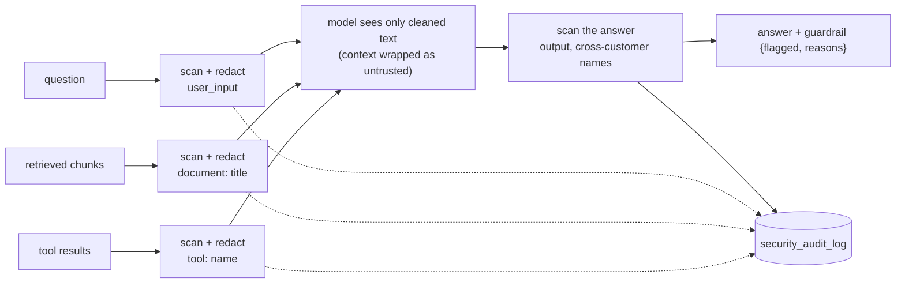
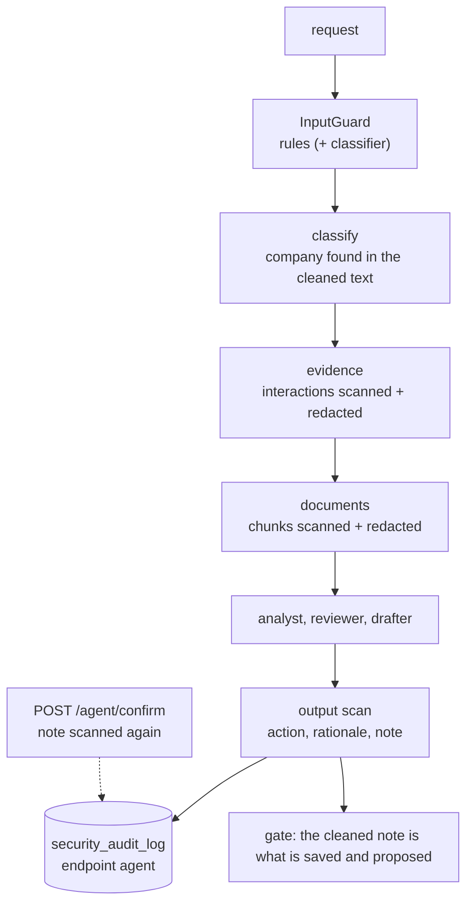

# Stage J6: guardrails and audit

Ports Python Stage 8 (prompt-injection guard, output guard, security audit log). Decisions: [ADR 0013](../adr/0013-rule-based-guard-and-audit-log.md). Cut into slices: **J6.1** the guard, the audit log and the chat routes (this page), **J6.2** the agent and the optional LLM classifier (below). Decisions for J6.2: [ADR 0014](../adr/0014-llm-classifier-and-agent-guard.md).

## J6.1: the guard on the chat routes

| Piece | File | Job | Python twin |
| --- | --- | --- | --- |
| The rules | `guard/PromptGuard.java` | scan and redact, output scan, report, wrap | `guardrails/prompt_guard.py` |
| Finishing an answer | `guard/ChatGuard.java` | scan the answer, merge, audit, build `guardrail` | `_finalize` in `routes/chat.py` |
| The audit log | `guard/SecurityAudit.java` | write rows (never fails a request), purge at startup | `guardrails/audit.py` |
| The read route | `guard/SecurityAuditController.java` | `GET /security-audit-log` with filters and 422s | `routes/security.py` |

### Concepts

1. **Untrusted text is data.** The model is told so (the wrapper tags), and the guard removes the obvious commands before it reads them.
2. **Neutralise, do not block.** Only the matched phrase goes; the request carries on.
3. **Defence in two places.** The input scan protects the model; the output scan protects the user (a leaked prompt, another customer's name in an answer scoped to one customer).
4. **Citations show the truth.** The model gets the cleaned chunk, the user sees the original, so a planted sentence is visible, not hidden.
5. **Detections are durable.** One row per detection with its place (`user_input`, `document: <title>`, `tool: <name>`, `output`) and an excerpt, so an attempt can be reviewed days later.
6. **Rules are a floor.** They catch known phrasings; the classifier (J6.2) catches some paraphrases.

## J6.2: the agent's guard and the LLM classifier

| Piece | File | Job | Python twin |
| --- | --- | --- | --- |
| Input guard and classifier | `guard/InputGuard.java`, `GuardProperties.java` | rules plus optional SAFE/UNSAFE classifier, fail open | `guardrails/llm_guard.py` |
| Agent nodes | `agent/AgentWorkflow.java` (`classify`, `evidence`, `documents`, `draft`) | scan the request, stored text, outputs | `agent/workflow.py` |
| Confirm | `agent/AgentController.java` | scan the note, audit, write the cleaned text | `routes/agent.py` |

### Concepts

1. **The agent reads data it did not write.** An old interaction or a document can carry a planted instruction; the agents are told to treat evidence as data, and the guard removes the obvious commands as well.
2. **Guard what the user will act on.** The task note becomes a CRM task; it is scanned like an answer.
3. **A classifier is a second opinion, not a filter.** It flags paraphrases the rules miss; it never edits text and fails open, because an outage of the guard model must not take the app down.
4. **Settings, not code, choose the layer.** `GUARD_MODE` and `GUARD_MODEL`; the default costs no model call.
