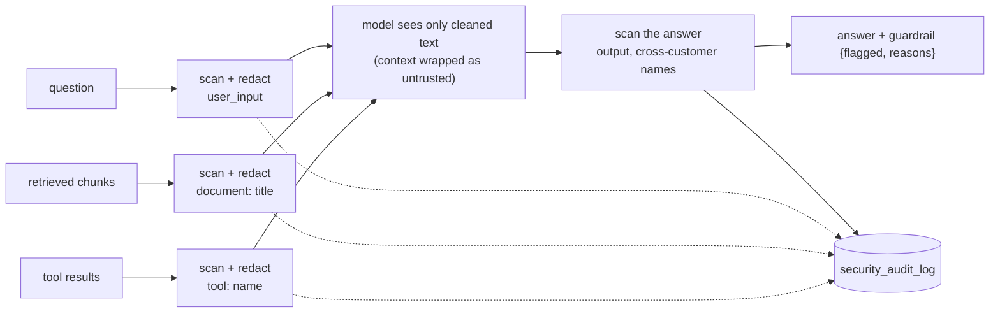

# Stage J6: guardrails and audit

Ports Python Stage 8 (prompt-injection guard, output guard, security audit log). Decisions: [ADR 0013](../adr/0013-rule-based-guard-and-audit-log.md). Cut into slices: **J6.1** the guard, the audit log and the chat routes (this page), J6.2 the agent and the optional LLM classifier.

## J6.1: the guard on the chat routes

| Piece | File | Job | Python twin |
| --- | --- | --- | --- |
| The rules | `guard/PromptGuard.java` | scan and redact, output scan, report, wrap | `guardrails/prompt_guard.py` |
| Finishing an answer | `guard/ChatGuard.java` | scan the answer, merge, audit, build `guardrail` | `_finalize` in `routes/chat.py` |
| The audit log | `guard/SecurityAudit.java` | write rows (never fails a request), purge at startup | `guardrails/audit.py` |
| The read route | `guard/SecurityAuditController.java` | `GET /security-audit-log` with filters and 422s | `routes/security.py` |

### Concepts

1. **Untrusted text is data.** The model is told so (the wrapper tags), and the guard removes the obvious commands before it reads them.
2. **Neutralise, do not block.** Only the matched phrase goes; the request carries on.
3. **Defence in two places.** The input scan protects the model; the output scan protects the user (a leaked prompt, another customer's name in an answer scoped to one customer).
4. **Citations show the truth.** The model gets the cleaned chunk, the user sees the original, so a planted sentence is visible, not hidden.
5. **Detections are durable.** One row per detection with its place (`user_input`, `document: <title>`, `tool: <name>`, `output`) and an excerpt, so an attempt can be reviewed days later.
6. **Rules are a floor.** They catch known phrasings; the classifier (J6.2) catches some paraphrases.
