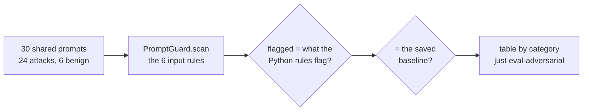
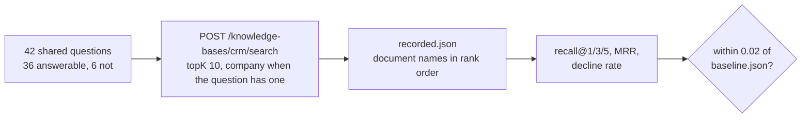
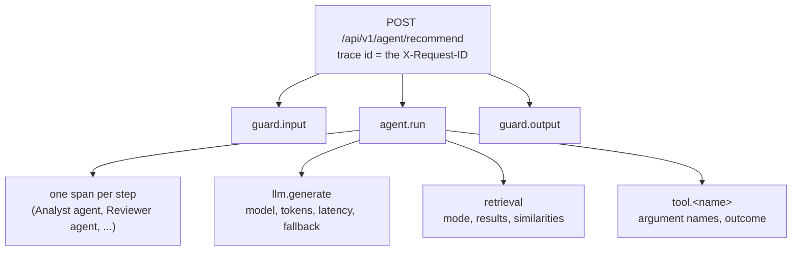

# Stage J7: evals and observability

Ports the Python edition's Stage 5 (and the 0.7 baseline). Decisions: [ADR 0025](../adr/0025-evals-as-shared-files-and-replayable-baselines.md). Cut into slices, one PR each: **J7.1** the adversarial set on the guard, **J7.2** the retrieval golden set (the harness; the recording is a separate step the owner approves), **J7.3** tracing (spans for the request, model calls, searches, tool calls, guard scans and agent steps), J7.4 guard comparison with the classifier, J7.5 tool and agent golden cases.

## In one minute

A test says "this still works". An **eval** says "how well does it work, on the same questions as last time". It needs three things: labelled inputs that do not change, a number computed the same way every time, and a saved earlier number to compare with. Both editions share the labelled inputs, so one set can measure both and show where they differ.

| Shop idea | Project idea | Where |
| --- | --- | --- |
| A fixed list of tricky customers to test a new cashier on | **The adversarial set**: 30 prompts, 24 attacks and 6 harmless | `evals/adversarial-prompts.json` |
| A test where you ask the shop assistant 42 set questions and note which shelf they point to | **The retrieval golden set**: 42 questions, each with the documents that answer it | `evals/golden/retrieval.json` |
| The cashier's score sheet from the first week | **The baseline**: the result per prompt, saved | `evals/adversarial/baseline.json` |
| Re-running the list after changing the rules | **The check** | `just eval-adversarial-check` |

## J7.1: the guard on the adversarial set

**Result.** 11 of 24 attacks flagged; 0 of 6 benign prompts flagged; the Java guard flags exactly the same prompts as the Python rules, all 30. By category: `jailbreak_keyword` 2 of 2, `override_instructions` 2 of 5, `reveal_system_prompt` 2 of 4, `role_override` 2 of 4, `cross_customer_exfiltration` 1 of 3, `fake_new_instructions` 1 of 2, `delimiter_injection` 1 of 1; `obfuscation`, `tool_abuse` and `indirect_injection` 0 of 1 each.

**What it means.** Rules catch phrasings they know. The 13 misses are paraphrases, role play, encoded text and instructions hidden in quoted text. That is the honest ceiling of a rule list, and why the guard neutralises instead of blocking and why an optional classifier exists (J6.2). The set is small and project-written; it is not evidence that the system is safe.

**Rule to remember.** *A guard's score on a fixed list is a thermometer reading: useful for noticing change, not proof of health.*

## Code tour

| | Where | What |
| --- | --- | --- |
| new | `evals/adversarial-prompts.json` | The shared labelled prompts, copied byte for byte from the Python edition |
| new | `guard/AdversarialEvalTests.java` | Scans each prompt, asserts parity with the Python rules, compares with the baseline |
| new | `evals/adversarial/baseline.json`, `show.py` | The saved result and the table printer |
| new | `justfile` | `eval-adversarial`, `eval-adversarial-check`, `eval-adversarial-baseline` |

## J7.2: how well the right document is found

**What it measures.** For each answerable question the harness takes the documents the search returned, best first (one entry per document), and asks: was a relevant document in the first 1, 3, 5 (recall@k: the share of the relevant documents found), and how high was the first relevant one (MRR: 1 divided by its position, averaged). For the 6 questions the documents do not answer, a good result is *nothing retrieved* (the similarity floor stops everything), counted as the decline rate.

**Where the numbers come from.** Recorded on 2026-11-14 with `gemini-embedding-001`, dense search, the 19 CRM documents (33 chunks) ingested fresh, and 42 live embedding calls per floor. Two recordings are committed, with a baseline for each:

| | recall@1 | recall@3 | recall@5 | MRR | unanswerable declined |
| --- | --- | --- | --- | --- | --- |
| floor 0.60 (the default today; `recorded.json`, `baseline.json`) | 0.843 | 0.972 | 0.986 | 1.000 | 0.667 (4 of 6) |
| floor 0.45 (`recorded-floor-0.45.json`, `baseline-floor-0.45.json`) | 0.843 | 0.972 | 0.986 | 1.000 | 0.000 (0 of 6) |
| Python edition's saved baseline (floor 0.45) | 0.843 | 0.986 | 0.986 | 1.000 | 0.000 |

What it shows: at both floors the answerable questions score the same (recall@1 0.843, recall@3 0.972, recall@5 0.986, MRR 1.000); only what is declined differs. MRR 1.000 and "first relevant document is not first: none" mean every answerable question has a relevant document at rank 1; recall@1 is lower because some questions have two relevant documents. At 0.60 four of the six unanswerable questions are declined. The two that still retrieve something (`unans-05`, a hardware discount for Harbor & Pine, and `unans-06`, how many employees Acme has) are about a real customer, close to the CRM's subject, which is the case ADR 0024 says a floor cannot catch. One answerable question, `ret-22` (implementation sessions per year), has a relevant document outside the first five. Against the Python edition's saved baseline the only difference is recall@3 (0.972 against 0.986); with 42 questions and one run I did not investigate it and would read it as the same. Not measured: hybrid search or a reranker.

**What to do with the result.** A baseline is a thermometer. Record, read the missed question ids, write the baseline, and from then on `just eval-retrieval-check` tells you when a change to chunking, the embedding model, hybrid search or the floor moved the score by more than 0.02. Recall on documents says the right file was among the first few; it does not say the answer was right.

**The one API change.** Three golden questions are about one company, so the knowledge-base search takes an optional `company` name, scoped as company questions are everywhere else (that company's documents and the company-agnostic ones). Java-only route; the shared contract is unchanged ([ADR 0026](../adr/0026-retrieval-golden-set-over-http.md)).

**Rule to remember.** *Record the expensive part once, replay the cheap part forever, and say which floor the recording used.*

| | Where | What |
| --- | --- | --- |
| new | `evals/retrieval/retrieval_eval.py` | Replay, check, record and write-baseline; the Python edition's scoring functions |
| new | `evals/retrieval/selftest.py` | 11 tests on a made-up recording, including the recording step against a stand-in API |
| change | `kb/KnowledgeBaseController.java` | Optional `company` in the search body |
| change | `kb/KnowledgeBaseFloorTests.java` | Three tests for it |
| new | `justfile` | `eval-retrieval`, `eval-retrieval-check`, `eval-retrieval-record`, `eval-retrieval-baseline`, `eval-retrieval-selftest` |

## J7.3: seeing what a request did (tracing)

Until now the only record of a request was one log line and the audit tables. They say *what* was done and *whether it was allowed*. They do not say why a run was slow, which model really answered after a fallback, how many tokens a call used or which agent step failed. A **trace** answers those.

| Shop idea | Project idea | In the code |
| --- | --- | --- |
| A receipt for one customer visit, listing every counter they stopped at | **A trace**: everything one request did | one trace per HTTP request, `RequestIdFilter` |
| One line on the receipt (counter, minutes, what was bought) | **A span**: one timed step | `Tracing.span(...)` in `observability/Tracing.java` |
| Counters are nested: "checkout" contains "scan item" | **Parent and child spans** | `agent.run` contains one span per step |
| A standard receipt format every till can print | **OpenTelemetry** over OTLP | Langfuse reads it; so could any other viewer |

**Off by default.** With `TRACING_ENABLED` unset there is no exporter, no thread and no network, and the traced code runs as before. Turn it on and spans go, in a background thread, to `TRACING_ENDPOINT` (Langfuse's OpenTelemetry endpoint by default). A broken or unreachable receiver costs the request nothing, and a failure to set tracing up is logged and the API starts without it.

**A trace is a receipt, not a copy of the conversation.** Spans carry counts, names, ids, sizes and durations: tokens, milliseconds, how many results, which tool and the *names* of its arguments, how many guard rules fired. They never carry what the user typed, a prompt, an answer, document text, a tool argument's value or the name of a rule. Unlike the Python edition there is no setting to switch content on. A test sends a question and a scripted answer through the real application and checks that no span holds either.

**The request id is the trace id.** Every response already carries `X-Request-ID`. When it is 32 hex characters (the generated ones are) the trace uses it, so one id finds the log lines, the response header and the trace.

**Across threads.** The agent graph runs on other threads and OpenTelemetry's context belongs to a thread, so the run's context is handed to the graph's threads explicitly. Without that, the model calls and searches inside a run would each start a trace of their own. A test removes the hand-over and fails.

**The audit tables stay.** Traces are for understanding and may be deleted; audit rows are the record.

**What was measured, and what was not.** Measured: the behaviour above, by tests with an in-memory exporter; the wire format (path `/api/public/otel/v1/traces`, Basic auth, `x-langfuse-ingestion-version: 4`, protobuf body) against a stand-in receiver on localhost; and the cost of one span in a warmed-up loop on this laptop, one run: about 1 microsecond with tracing off, about 7 microseconds on with a no-op exporter behind the batch processor (no network), against model calls that take seconds. Not measured: an export to a real Langfuse, request latency end to end with tracing on, and memory.

**Rule to remember.** *Record how long and how many; never what was said; and never let the recording break the thing being recorded.*

### Code tour: J7.3

| | Where | What |
| --- | --- | --- |
| new | `observability/Tracing.java` | The only class that knows OpenTelemetry: `span`, `requestSpan`, `finishedSpan`, `current`/`within`, attribute cleaning, never raises |
| new | `observability/TracingProperties.java`, `TracingLifecycle.java`, `OtlpExporters.java` | The settings, start and stop, and the exporter for Langfuse's endpoint |
| change | `web/RequestIdFilter.java` | The request span (not `/health`) with the request id as trace id |
| change | `llm/ModelGateway.java` | An `llm.generate` span per call |
| change | `rag/Retriever.java` | A `retrieval` span per search |
| change | `mcp/ToolCallRunner.java` | A `tool.<name>` span per tool call |
| change | `guard/InputGuard.java`, `ChatGuard.java` | `guard.input` and `guard.output` spans |
| change | `agent/Trace.java`, `AgentWorkflow.java`, `SupervisorWorkflow.java`, `ApprovalGate.java` | Every recorded step is also a span; `agent.run` and `agent.resume`; the context travels to the graph's threads |
| new | tests: `TracingTests`, `OtlpExportTests`, `TracingLifecycleTests`, `GatewayTracingTests`, `GuardTracingTests`, `AgentTracingTests`, one in `HybridRetrievalTests` | In-memory exporter, a localhost receiver, no key, no network |
