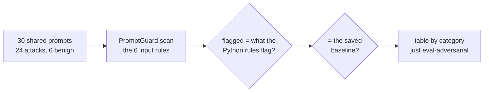

# Stage J7: evals and observability

Ports the Python edition's Stage 5 (and the 0.7 baseline). Decisions: [ADR 0025](../adr/0025-evals-as-shared-files-and-replayable-baselines.md). Cut into slices, one PR each: **J7.1** the adversarial set on the guard (this guide so far), then J7.2 retrieval golden set, J7.3 tracing, J7.4 guard comparison with the classifier, J7.5 tool and agent golden cases.

## In one minute

A test says "this still works". An **eval** says "how well does it work, on the same questions as last time". It needs three things: labelled inputs that do not change, a number computed the same way every time, and a saved earlier number to compare with. Both editions share the labelled inputs, so one set can measure both and show where they differ.

| Shop idea | Project idea | Where |
| --- | --- | --- |
| A fixed list of tricky customers to test a new cashier on | **The adversarial set**: 30 prompts, 24 attacks and 6 harmless | `evals/adversarial-prompts.json` |
| The cashier's score sheet from the first week | **The baseline**: the result per prompt, saved | `evals/adversarial/baseline.json` |
| Re-running the list after changing the rules | **The check** | `just eval-adversarial-check` |

## J7.1: the guard on the adversarial set

**Result.** 11 of 24 attacks flagged; 0 of 6 benign prompts flagged; the Java guard flags exactly the same prompts as the Python rules, all 30. By category: `jailbreak_keyword` 2 of 2, `override_instructions` 2 of 5, `reveal_system_prompt` 2 of 4, `role_override` 2 of 4, `cross_customer_exfiltration` 1 of 3, `fake_new_instructions` 1 of 2, `delimiter_injection` 1 of 1; `obfuscation`, `tool_abuse` and `indirect_injection` 0 of 1 each.

**What it means.** Rules catch phrasings they know. The 13 misses are paraphrases, role play, encoded text and instructions hidden in quoted text. That is the honest ceiling of a rule list, and why the guard neutralises instead of blocking and why an optional classifier exists (J6.2). The set is small and project-written; it is not evidence that the system is safe.

**Rule to remember.** *A guard's score on a fixed list is a thermometer reading: useful for noticing change, not proof of health.*

## Code tour

| | Where | What |
| --- | --- | --- |
| new | `evals/adversarial-prompts.json` | The shared labelled prompts, copied byte for byte from the Python edition |
| new | `guard/AdversarialEvalTests.java` | Scans each prompt, asserts parity with the Python rules, compares with the baseline |
| new | `evals/adversarial/baseline.json`, `show.py` | The saved result and the table printer |
| new | `justfile` | `eval-adversarial`, `eval-adversarial-check`, `eval-adversarial-baseline` |
