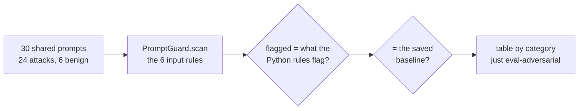
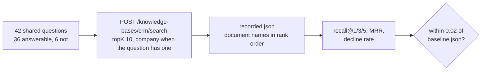

# Stage J7: evals and observability

Ports the Python edition's Stage 5 (and the 0.7 baseline). Decisions: [ADR 0025](../adr/0025-evals-as-shared-files-and-replayable-baselines.md). Cut into slices, one PR each: **J7.1** the adversarial set on the guard, **J7.2** the retrieval golden set (the harness; the recording is a separate step the owner approves), then J7.3 tracing, J7.4 guard comparison with the classifier, J7.5 tool and agent golden cases.

## In one minute

A test says "this still works". An **eval** says "how well does it work, on the same questions as last time". It needs three things: labelled inputs that do not change, a number computed the same way every time, and a saved earlier number to compare with. Both editions share the labelled inputs, so one set can measure both and show where they differ.

| Shop idea | Project idea | Where |
| --- | --- | --- |
| A fixed list of tricky customers to test a new cashier on | **The adversarial set**: 30 prompts, 24 attacks and 6 harmless | `evals/adversarial-prompts.json` |
| A test where you ask the shop assistant 42 set questions and note which shelf they point to | **The retrieval golden set**: 42 questions, each with the documents that answer it | `evals/golden/retrieval.json` |
| The cashier's score sheet from the first week | **The baseline**: the result per prompt, saved | `evals/adversarial/baseline.json` |
| Re-running the list after changing the rules | **The check** | `just eval-adversarial-check` |

## J7.1: the guard on the adversarial set

**Result.** 11 of 24 attacks flagged; 0 of 6 benign prompts flagged; the Java guard flags exactly the same prompts as the Python rules, all 30. By category: `jailbreak_keyword` 2 of 2, `override_instructions` 2 of 5, `reveal_system_prompt` 2 of 4, `role_override` 2 of 4, `cross_customer_exfiltration` 1 of 3, `fake_new_instructions` 1 of 2, `delimiter_injection` 1 of 1; `obfuscation`, `tool_abuse` and `indirect_injection` 0 of 1 each.

**What it means.** Rules catch phrasings they know. The 13 misses are paraphrases, role play, encoded text and instructions hidden in quoted text. That is the honest ceiling of a rule list, and why the guard neutralises instead of blocking and why an optional classifier exists (J6.2). The set is small and project-written; it is not evidence that the system is safe.

**Rule to remember.** *A guard's score on a fixed list is a thermometer reading: useful for noticing change, not proof of health.*

## Code tour

| | Where | What |
| --- | --- | --- |
| new | `evals/adversarial-prompts.json` | The shared labelled prompts, copied byte for byte from the Python edition |
| new | `guard/AdversarialEvalTests.java` | Scans each prompt, asserts parity with the Python rules, compares with the baseline |
| new | `evals/adversarial/baseline.json`, `show.py` | The saved result and the table printer |
| new | `justfile` | `eval-adversarial`, `eval-adversarial-check`, `eval-adversarial-baseline` |

## J7.2: how well the right document is found

**What it measures.** For each answerable question the harness takes the documents the search returned, best first (one entry per document), and asks: was a relevant document in the first 1, 3, 5 (recall@k: the share of the relevant documents found), and how high was the first relevant one (MRR: 1 divided by its position, averaged). For the 6 questions the documents do not answer, a good result is *nothing retrieved* (the similarity floor stops everything), counted as the decline rate.

**Where the numbers come from.** Not yet measured in the Java edition: this slice ships the harness only, proved on a made-up recording whose results are worked by hand (`just eval-retrieval-selftest`). The real recording costs about 42 embedding calls and needs `GOOGLE_API_KEY`. For reference, the Python edition's saved baseline (dense search, floor 0.45, `evals/baseline/v2.json` there) is recall@1 0.843, recall@3 0.986, recall@5 0.986, MRR 1.0 and decline rate 0.0: at the old floor the six unanswerable questions all still retrieved something. Both editions now default to a floor of 0.60 ([ADR 0024](../adr/0024-crm-similarity-floor-0-60.md)), so compare like with like: record with `MIN_SIMILARITY=0.45` to reproduce that baseline, or at the default to see what runs today.

**What to do with the result.** A baseline is a thermometer. Record, read the missed question ids, write the baseline, and from then on `just eval-retrieval-check` tells you when a change to chunking, the embedding model, hybrid search or the floor moved the score by more than 0.02. Recall on documents says the right file was among the first few; it does not say the answer was right.

**The one API change.** Three golden questions are about one company, so the knowledge-base search takes an optional `company` name, scoped as company questions are everywhere else (that company's documents and the company-agnostic ones). Java-only route; the shared contract is unchanged ([ADR 0026](../adr/0026-retrieval-golden-set-over-http.md)).

**Rule to remember.** *Record the expensive part once, replay the cheap part forever, and say which floor the recording used.*

| | Where | What |
| --- | --- | --- |
| new | `evals/retrieval/retrieval_eval.py` | Replay, check, record and write-baseline; the Python edition's scoring functions |
| new | `evals/retrieval/selftest.py` | 11 tests on a made-up recording, including the recording step against a stand-in API |
| change | `kb/KnowledgeBaseController.java` | Optional `company` in the search body |
| change | `kb/KnowledgeBaseFloorTests.java` | Three tests for it |
| new | `justfile` | `eval-retrieval`, `eval-retrieval-check`, `eval-retrieval-record`, `eval-retrieval-baseline`, `eval-retrieval-selftest` |
