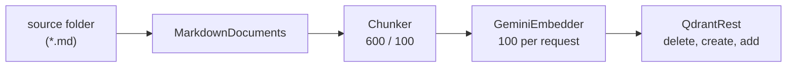
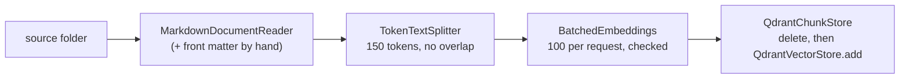

# Stage J8.2: RAG ingestion, built several ways

Plan: [`docs/roadmap.md`](../roadmap.md) ("Stage J8"). Decisions: [ADR 0033](../adr/0033-rag-ingestion-comparison.md). Code: [`comparisons/rag-ingestion/`](../../comparisons/README.md). This page grows with each approach: **J8.2a `handWritten`** (here), J8.2b `withSpringAi` and J8.2c `withLangchain4j` (later slices), J8.2d the side-by-side.

## In one minute

A model can only use what you hand it. **Ingestion** is the shop that stocks the shelves before anyone asks a question: take the documents, cut them into pieces small enough to match against a question, turn each piece into a list of numbers (its **embedding**, a fingerprint of its meaning) and file the pieces on a shelf (the **vector store**) where "find the pieces that mean something close to this question" is fast.

| Shop idea | Project idea | Where |
| --- | --- | --- |
| Unpack the boxes | **Read** the markdown files, with the title and company from the top block | `MarkdownDocuments.java` |
| Cut each page into index cards | **Chunk**: 600 characters, 100 shared with the next card | `Chunker.java` |
| Write a meaning-fingerprint on every card | **Embed**: ask Gemini for one vector per chunk | `GeminiEmbedder.java` |
| File the cards on the shelf | **Store** in a Qdrant collection, with the text kept for citing | `QdrantRest.java` |
| The foreman | The pipeline, in order, and the rules around it | `HandWrittenIngest.java` |

## J8.2a: ingestion by hand

No AI framework: JDK `HttpClient` and Jackson only, calling Gemini's `batchEmbedContents` and Qdrant's REST API directly.

**The rules the code enforces** (each has a test):
- Embedding runs **before** the old collection is removed, so a failed run leaves the previous collection as it was.
- Gemini gets at most 100 texts per request (250 texts: 3 requests); Qdrant gets 64 points per request.
- The key is sent in a header, never in the URL; errors say the HTTP status only, never what the service replied.
- The number of vectors must equal the number of texts, and each must have the configured length; otherwise the run stops.
- A file with no text is skipped; other file types are ignored.
- The caller cannot pick the folder or the collection.

**Measured here:** the behaviour of all the steps against scripted stand-ins (fake Gemini and Qdrant servers). **Not measured:** a live run, real timing, real quota use, and whether these vectors search as well as the application's (no live call was made).

**Rule to remember.** *Do the step that can fail and costs money first; replace what exists only when you hold the new result.*

## J8.2b: ingestion with Spring AI

The same pipeline and the same HTTP face, with a Spring AI class for each step: `MarkdownDocumentReader` reads, `TokenTextSplitter` cuts, `GoogleGenAiTextEmbeddingModel` embeds, `QdrantVectorStore` stores. Port 18112, collection `compare_withspringai`. Decisions and the full tables: [ADR 0034](../adr/0034-rag-ingestion-with-spring-ai.md).

**What Spring AI gave, without a line of ours** (measured in `SpringAiIngestionBehaviourTests`): reading a markdown file into one document per heading; a splitter and a tokenizer; the Gemini request and the response parsing; the key in a header; the collection created with the right size and the cosine distance; points with the metadata as payload.

**What it did not give, and what that took:**

| The rule | What Spring AI does | In `withSpringAi` |
| --- | --- | --- |
| Embed first, replace the collection after | The store always embeds the documents itself and cannot recreate a collection | Vectors computed first and handed to the store through `PrecomputedEmbeddings`; the collection deleted through the Qdrant client |
| At most 100 texts per request | Sends all in one request | `BatchedEmbeddings` |
| The right number and length of vectors | Accepts wrong ones silently | Checked, the run stops |
| Errors say the status only | The exception carries the service's reply | Caught and reduced to the status |
| One failed call is not repeated five times | 5 requests and about 35 seconds | One attempt, set on the SDK |
| Front matter gives title and company | Misread by the reader (its key lines become a heading, only the last survives) | Read and cut off by hand before the reader sees the file |
| Offsets of a chunk | Not available | Not stored |

**Four differences you would not guess.** The reader joins paragraphs with **no separator** ("there.More"). The splitter counts **tokens** and has **no overlap**, so its chunks differ from handWritten's 600 characters with 100 overlap (on the sample documents: 20 chunks of about 570 characters against about 28 of up to 600). The Gemini model **never sends the task type**, so the vectors are not asked for as "document" vectors. And a text of 3 characters is dropped. Whether any of this changes search quality was not measured.

**Measured here:** the library's behaviour in each step against a scripted Gemini server, the real Qdrant store against a throw-away Qdrant (when `QDRANT_GRPC_PORT` is set), and ours against stand-ins. **Not measured:** a call to the real Gemini service, real quota use, and search quality.

**Rule to remember.** *A library class that does a step well does not know your order of steps. Find out what it does on failure before you let it hold the only copy.*
## J8.2c: ingestion with LangChain4j

The same backend with LangChain4j 1.23.0: its loader reads the files, `DocumentSplitters.recursive(600, 100)` cuts them, its Gemini embedding model embeds, and **`EmbeddingStoreIngestor`** runs split, embed and store as one call into a Qdrant collection (`compare_withlangchain4j`, port 18113). Decisions and the measured tables: [ADR 0035](../adr/0035-rag-ingestion-with-langchain4j.md).

**What LangChain4j gave, without a line of ours** (measured in `LangChain4jIngestionBehaviourTests`): the loader and its glob, a splitter that cuts at paragraph and sentence boundaries, batching of embedding requests (250 texts made 3 requests), the key in a header, and an ingestor that embeds everything before it touches the store once.

**What it did not give, and what that took:**

| The rule | What LangChain4j does | In `withLangchain4j` |
| --- | --- | --- |
| Front matter is not text | Kept in the text; the splitter cuts it into chunks and **repeats it** in the next | Cut off before splitting; title and company parsed by hand |
| Embed first, then replace | The ingestor embeds all, then stores once | `ReplacingStore` resets the collection inside that one store call |
| The collection exists with the right size | The store **does not create it** (NOT_FOUND) | Created with Qdrant's client; its own `recreateCollectionAsync` **fails on a missing collection** |
| Check the vectors | A short reply or a wrong-length vector is **not detected** | `CheckedEmbeddings` |
| Errors without the service's reply | The exception message **is** the service's reply | Rewritten to status only |
| No key, nothing called | The library **calls anyway** | Checked first |
| Character offsets | None | Not in the payload (stated) |

**One difference from Spring AI worth noting.** LangChain4j lets a wrapper put the replace between embedding and storing, so the ingestor can still be used; Spring AI's store always embeds by itself, so the J8.2b approach embeds first by hand.

**Measured here:** the library's behaviour and ours against a fake Gemini, and the store against a throw-away Qdrant (the live tests, skipped by default). **Not measured:** a real Gemini call, chunk counts against `handWritten`, search quality, quota.

**Rule to remember.** *Run the library against the real service once: two of our own tests failed only on a real Qdrant, because a recreate that works when the collection exists fails when it does not.*

## Code tour

| | Where | What |
| --- | --- | --- |
| new | `comparisons/common/.../Ingest.java`, `IngestBackendServer.java` | The interface every approach implements and the shared HTTP face |
| new | `comparisons/rag-ingestion/handWritten/` | `MarkdownDocuments`, `Chunker`, `GeminiEmbedder`, `QdrantRest`, `HandWrittenIngest`, `HandWrittenIngestMain` (port 18111) |
| new | `justfile` | `comparisons-ingest-hand-written` |
| new (J8.2b) | `comparisons/rag-ingestion/withSpringAi/` | `MarkdownSections` (the reader and the front matter), `SpringAiIngest` (the pipeline and the splitter), `BatchedEmbeddings`, `QdrantChunkStore`, `PrecomputedEmbeddings`, `ChunkStore`, `WithSpringAiIngestMain` (port 18112) |
| new (J8.2b) | `justfile` | `comparisons-ingest-with-spring-ai` |
| new (J8.2c) | `comparisons/rag-ingestion/withLangchain4j/` | `LangChain4jIngest`, `SourceDocuments`, `CheckedEmbeddings`, `ReplacingStore`, `QdrantCollection`, `WithLangchain4jIngestMain` (port 18113); justfile `comparisons-ingest-with-langchain4j` |

## Questions to try

1. Why is the collection replaced only after every chunk has its vector? What would a run that fails at chunk 200 leave behind the other way round?
2. The API takes no folder and no collection. What could a caller do if it did?
3. Chunks are cut by character count. What kind of sentence gets damaged, and what does the 100-character overlap do about it?
