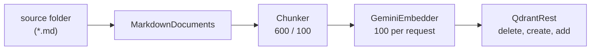

# Stage J8.2: RAG ingestion, built several ways

Plan: [`docs/roadmap.md`](../roadmap.md) ("Stage J8"). Decisions: [ADR 0033](../adr/0033-rag-ingestion-comparison.md). Code: [`comparisons/rag-ingestion/`](../../comparisons/README.md). This page grows with each approach: **J8.2a `handWritten`** (here), J8.2b `withSpringAi` and J8.2c `withLangchain4j` (later slices), J8.2d the side-by-side.

## In one minute

A model can only use what you hand it. **Ingestion** is the shop that stocks the shelves before anyone asks a question: take the documents, cut them into pieces small enough to match against a question, turn each piece into a list of numbers (its **embedding**, a fingerprint of its meaning) and file the pieces on a shelf (the **vector store**) where "find the pieces that mean something close to this question" is fast.

| Shop idea | Project idea | Where |
| --- | --- | --- |
| Unpack the boxes | **Read** the markdown files, with the title and company from the top block | `MarkdownDocuments.java` |
| Cut each page into index cards | **Chunk**: 600 characters, 100 shared with the next card | `Chunker.java` |
| Write a meaning-fingerprint on every card | **Embed**: ask Gemini for one vector per chunk | `GeminiEmbedder.java` |
| File the cards on the shelf | **Store** in a Qdrant collection, with the text kept for citing | `QdrantRest.java` |
| The foreman | The pipeline, in order, and the rules around it | `HandWrittenIngest.java` |

## J8.2a: ingestion by hand

No AI framework: JDK `HttpClient` and Jackson only, calling Gemini's `batchEmbedContents` and Qdrant's REST API directly.

**The rules the code enforces** (each has a test):
- Embedding runs **before** the old collection is removed, so a failed run leaves the previous collection as it was.
- Gemini gets at most 100 texts per request (250 texts: 3 requests); Qdrant gets 64 points per request.
- The key is sent in a header, never in the URL; errors say the HTTP status only, never what the service replied.
- The number of vectors must equal the number of texts, and each must have the configured length; otherwise the run stops.
- A file with no text is skipped; other file types are ignored.
- The caller cannot pick the folder or the collection.

**Measured here:** the behaviour of all the steps against scripted stand-ins (fake Gemini and Qdrant servers). **Not measured:** a live run, real timing, real quota use, and whether these vectors search as well as the application's (no live call was made).

**Rule to remember.** *Do the step that can fail and costs money first; replace what exists only when you hold the new result.*

## Code tour

| | Where | What |
| --- | --- | --- |
| new | `comparisons/common/.../Ingest.java`, `IngestBackendServer.java` | The interface every approach implements and the shared HTTP face |
| new | `comparisons/rag-ingestion/handWritten/` | `MarkdownDocuments`, `Chunker`, `GeminiEmbedder`, `QdrantRest`, `HandWrittenIngest`, `HandWrittenIngestMain` (port 18111) |
| new | `justfile` | `comparisons-ingest-hand-written` |

## Questions to try

1. Why is the collection replaced only after every chunk has its vector? What would a run that fails at chunk 200 leave behind the other way round?
2. The API takes no folder and no collection. What could a caller do if it did?
3. Chunks are cut by character count. What kind of sentence gets damaged, and what does the 100-character overlap do about it?
