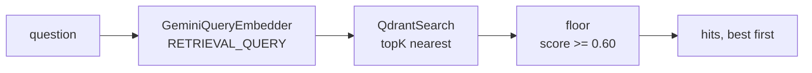

# Stage J8.3: RAG retrieval, built several ways

Plan: [`docs/roadmap.md`](../roadmap.md) ("Stage J8"). Decisions: [ADR 0036](../adr/0036-rag-retrieval-comparison.md) (the contract). Code: [`comparisons/rag-retrieval/`](../../comparisons/README.md). One section per approach, added as each is built: **J8.3a `handWritten`** (here), J8.3b `withSpringAi`, J8.3c `withLangchain4j`, and J8.3d the three side by side.

## In one minute

Ingestion (J8.2) filed the index cards on the shelf. **Retrieval** is the librarian: you ask a question, the librarian writes the question's meaning-fingerprint (an **embedding**), asks the shelf for the cards whose fingerprints are closest (**similarity search**), and hands over only the cards that are close *enough*: the **similarity floor**. A floor of 0.60 means "a card must score at least 0.60 out of 1 to be shown". Too low and unrelated cards slip in; too high and useful ones are lost.

| Shop idea | Project idea | Where |
| --- | --- | --- |
| Write the question's fingerprint | **Embed the question** (Gemini, task type "query") | `GeminiQueryEmbedder.java` |
| Ask the shelf for the closest cards | **Search** Qdrant for the `topK` nearest chunks | `QdrantSearch.java` |
| Hand over only close-enough cards | **The floor**: keep chunks with score at or above it, best first | `HandWrittenRetrieve.java` |

## J8.3a: retrieval by hand

No AI framework: JDK `HttpClient` and Jackson only, calling Gemini's `embedContent` and Qdrant's `points/query` directly. It searches `compare_handwritten`, the collection the J8.2a ingestion built.

**The rules the code enforces** (each has a test):
- The answer says how many chunks the store returned (`considered`) and how many passed the floor (`kept`), so a floor that is too strict is visible.
- A chunk exactly at the floor is kept; hits are best first; nothing above the floor gives no hits, not an error.
- The key travels in a header, never in the URL; errors say the HTTP status only, never what the service replied.
- No key means nothing is called; a failed embedding never reaches the store.
- A missing collection says to run the ingestion first.
- The caller cannot choose the collection; `topK` is 1 to 20, the floor 0 to 1, the question at most 1,000 characters.

**Measured here:** the behaviour of every step against scripted stand-ins (fake Gemini and Qdrant servers). **Not measured:** a live search, real scores, whether `RETRIEVAL_QUERY` vectors score differently from other task types, speed or quota.

**Left out, on purpose:** hybrid keyword search and a reranker (ADR 0036).

**Rule to remember.** *A threshold is only useful if you can see what it removed: report how many were considered as well as how many were kept.*

## J8.3b: retrieval with Spring AI

The same backend, the same HTTP face, with Spring AI doing the embedding and the search in one call: `QdrantVectorStore.similaritySearch` over the Gemini embedding model, against `compare_withspringai` (port 18122). Decisions and the measured tables: [ADR 0037](../adr/0037-rag-retrieval-with-spring-ai.md).

**What Spring AI gave, without a line of ours** (measured in `SpringAiRetrievalBehaviourTests` and `SpringAiQdrantSearchTests`): the question is embedded by the store itself in one request, the key goes in a header, the score is Qdrant's cosine similarity, results come best first, `topK` is honoured, and the chunk text and metadata come back ready to use.

**What it did not give, and what that took:**

| The rule | What Spring AI does | In `withSpringAi` |
| --- | --- | --- |
| A chunk at the floor is kept | Its threshold is **strict**, and "accept all" drops chunks of cosine 0 or below | Search with no threshold, apply the floor in our code |
| `considered` is how many the store returned | Chunks it drops by the threshold are not counted | Follows from the line above |
| Errors without the service's reply | A refusal's message **contains the service's reply** | `CheckedEmbeddings` and `QdrantChunkSearch` reduce errors to the status |
| A vector of the right length | A wrong-length vector is **returned as it is** | Checked before the store is asked |
| A missing collection says to ingest first | A gRPC `NOT_FOUND` that names the collection | Mapped to the sentence |
| Query task type | **Never sent** | Cannot be done: a difference from `handWritten` |

**One number worth remembering.** A chunk stored with a score of 0.6 comes back as **0.6000000238418579**: Qdrant scores are floats, widened to doubles. The floor of 0.60 therefore keeps it, and so does `handWritten`, which reads the same float as text.

**Measured here:** the library's behaviour and ours against a fake Gemini, and the store against a throw-away Qdrant (skipped by default). **Not measured:** a real Gemini call, whether the missing query task type changes the scores, speed, quota.

**Rule to remember.** *A library's threshold is a decision made for you: check whether it is strict, and what it hides from your counts.*
## J8.3c: retrieval with LangChain4j

The same backend with LangChain4j 1.23.0: its Gemini embedding model embeds the question and its `QdrantEmbeddingStore` searches `compare_withlangchain4j` (port 18123). Decisions and the measured tables: [ADR 0038](../adr/0038-rag-retrieval-with-langchain4j.md).

**The one thing to know: the score is not the cosine.** LangChain4j's score is a **relevance score `(cosine + 1) / 2`**, from 0 (opposite) to 1 (the same), and its `minScore` is compared with that. Measured against known vectors: the same vector scores 1.0, an orthogonal one 0.5, an opposite one 0.0. **A floor of 0.60 handed straight to `minScore` would really be a cosine of 0.20**: it would return results, look right, and let in far less relevant chunks, with no error. The backend therefore searches with `minScore` 0, converts each score back (`cosine = 2 * score - 1`) and applies the floor itself, so 0.60 means the same here as in `handWritten`.

**What LangChain4j gave, without a line of ours:** a one-line embedding of the question (one request, key in a header), a one-call search that returns the chunks best first with their metadata, and a store that refuses a query of the wrong length and reports a missing collection (both measured).

**What it did not give, and what that took:**

| The rule | What LangChain4j does | In `withLangchain4j` |
| --- | --- | --- |
| The floor is a cosine of 0.60 | `minScore` is on the relevance scale | Converted back; the floor applied here |
| `considered` and `kept` | `minScore` hides how many there were | Search with `minScore` 0 and filter here |
| No key, nothing called | The library **calls anyway** | Checked first |
| Check the vector | A wrong-length reply is **not detected** | Checked |
| Errors without the service's reply | The exception message **is** the service's reply | Reduced to status only; the store's gRPC status to a fixed sentence |
| A missing collection | `NOT_FOUND` | "Run the ingestion for this approach first" |

**Measured here:** the library's behaviour against a fake Gemini, and the store and the whole search against a real throw-away Qdrant with vectors of known cosine (those tests are skipped unless `QDRANT_GRPC_PORT` is set). **Not measured:** a live Gemini call, search quality, speed, quota.

**Rule to remember.** *A threshold is only as good as the scale it is on. Find out what scale a library's score is on before you hand it a number that was calibrated on another.*

## Code tour

| | Where | What |
| --- | --- | --- |
| new | `comparisons/common/.../Retrieve.java`, `RetrieveBackendServer.java` | The interface every approach implements and the shared HTTP face |
| new | `comparisons/rag-retrieval/handWritten/` | `GeminiQueryEmbedder`, `QdrantSearch`, `HandWrittenRetrieve`, `HandWrittenRetrieveMain` (port 18121) |
| new | `justfile` | `comparisons-retrieve-hand-written` |
| new (J8.3b) | `comparisons/rag-retrieval/withSpringAi/` | `SpringAiRetrieve`, `ChunkSearch`, `QdrantChunkSearch`, `CheckedEmbeddings`, `WithSpringAiRetrieveMain` (port 18122); justfile `comparisons-retrieve-with-spring-ai` |
| new (J8.3c) | `comparisons/rag-retrieval/withLangchain4j/` | `LangChain4jRetrieve`, `QueryEmbedder`, `WithLangchain4jRetrieveMain` (port 18123); justfile `comparisons-retrieve-with-langchain4j` |

## Questions to try

1. Ask the same question with floors 0.45, 0.60 and 0.75. How do `considered` and `kept` change, and which hits disappear first?
2. Ask something the documents do not cover (a refund policy). What does the floor do, and what would the model have to say?
3. Why does the answer report `considered` as well as `kept`?
