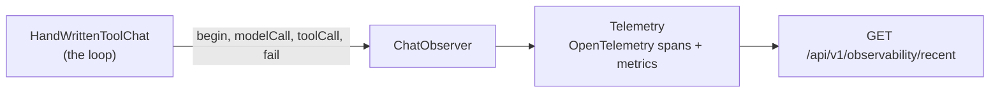
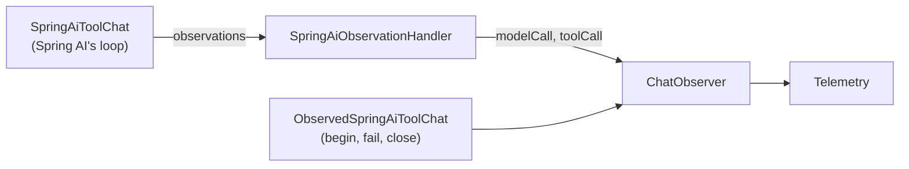
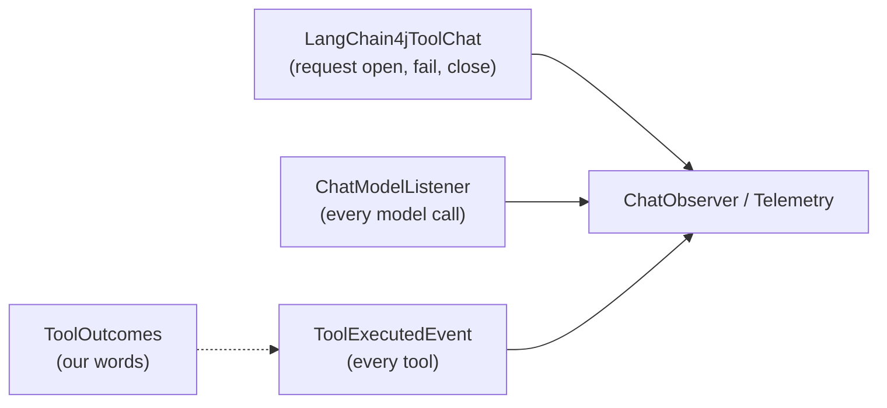

# Stage J8.4: observability, built several ways

Plan: [`docs/roadmap.md`](../roadmap.md) ("Stage J8"). Decisions: [ADR 0039](../adr/0039-observability-comparison.md). Code: [`comparisons/observability/`](../../comparisons/README.md) and the shared `comparisons/common` (`ChatObserver`, `Telemetry`). One section per approach (J8.4a `handWritten`, J8.4b `withSpringAi`, J8.4c `withLangchain4j`) and, last, J8.4d, the three side by side. The per-approach decisions: [ADR 0040](../adr/0040-observability-with-spring-ai.md), [ADR 0041](../adr/0041-observability-with-langchain4j.md).

## In one minute

A backend that answers a question is a black box: you see the answer, not why it took four seconds, which model replied, how many tokens it cost or whether a tool failed. **Observability** is the flight recorder. Every question leaves a **trace** (a timeline of what happened, in steps called **spans**) and adds to **metrics** (running counts and timings). The rule that matters: the recorder writes down **what happened, never what was said**. No question, no answer, no document text goes into it.

| Shop idea | Project idea | Where |
| --- | --- | --- |
| A receipt for every customer: when, how long, which counter | **A trace**: one `chat.request` span for the question | `Telemetry.java` |
| A line on the receipt for each phone call to the supplier | **A `llm.generate` span** per model call, with the model and tokens | `Telemetry.java` |
| A line for each item fetched from the stockroom | **A `tool.<name>` span** per tool, with its outcome | `Telemetry.java` |
| The shop's daily tally sheet | **Metrics**: requests, model calls, tool calls, tokens, duration | `Telemetry.java` |

## J8.4a: observation by hand

The hand-written tool loop (J8.1a) with an observer. It is the same loop; at the points where it already holds the facts (the model's reply, a tool's result) it reports them. Port 18131.

**What is recorded** (ADR 0039): a root `chat.request` span; one `llm.generate` span per model call (model, input and output tokens, outcome); one `tool.<name>` span per tool the model asked for (outcome: `ran`, `invalid_call`, `invalid_arguments` or `tool_error`); and metrics for requests, model calls, tool calls, tokens and duration.

**The rules the code enforces** (each has a test):
- A question with one tool is one trace: a request, two model calls and one tool call, all children of the request.
- Tokens come from the model's own reply; the metrics add them up (a tool-call reply of 15 in and 6 out plus a text reply of 20 in and 8 out make 35 in and 14 out).
- A model that fails, or a missing key, makes a failed request (`cc.status=error`, `cc.failure=unavailable`), and a failed model call is an `error` outcome.
- Bad arguments, arguments that are not JSON and a tool that throws are each a tool span with its own outcome, not a `ran` tool.
- **A tool name the model made up is recorded as `unknown`**, never under its own name.
- **No content is ever recorded:** a test checks that the question, the answer, a tool result and the arguments appear nowhere in any span, metric or the JSON view.
- With observation off, nothing is recorded and the answer is the same.

**Measured here:** the signals the loop produces for scripted questions (a fake model and CRM), in OpenTelemetry's in-memory exporters. **Not measured:** a live model, real timings, export to Langfuse or another OTLP receiver.

**Rule to remember.** *Record what happened, never what was said. The question and the answer are the customer's, not the recorder's.*

## J8.4b: observation with Spring AI

The same flow, the same signals, but the events come from **Spring AI's own observations** instead of reports written into the loop. Spring AI starts an observation for every model call and every tool call; a handler on the registry turns them into the shared signals. Port 18132. Decisions and the measured tables: [ADR 0040](../adr/0040-observability-with-spring-ai.md).

**What Spring AI gave, without a line of ours** (measured in `SpringAiObservabilityBehaviourTests`): one observation per model call with the model, the **token counts** and the error; one per tool call with the tool's name; handlers that run on the asking thread; and key values that carry no question, answer, argument or result by default.

**What it did not give, and what that took:**

| The signal | What Spring AI does | In `withSpringAi` |
| --- | --- | --- |
| Tool outcome `invalid_arguments`, `skipped` | A refused call looks like a success | Our tool method adds the word to the current tool observation |
| Tool outcome `invalid_call`, `tool_error` | A thrown tool leaves **no error** on its observation | Our exception processor adds the word |
| Which question a call belongs to | The model and tool observations have **no parent**, even with an observation open | A per-question observation kept open on the thread; the handler walks the registry's scope chain (the question is not the top scope) |
| A safe tool name | A tool the model made up is observed **under its own name** | Reported as `unknown` |
| Never content | The key values are clean; the contexts hold the prompt, the answer, the arguments and the result | The handler reads only the model name, the tokens, the tool's name and our word |

**One difference you would not guess.** A fifth tool call in one reply is a `tool.<name>` span with the outcome **`skipped`** here; the hand-written loop drops the surplus calls and records nothing.

**Measured here:** the library's observations and our signals against a scripted model and CRM, including two questions at once. **Not measured:** a live model, real latencies, Spring AI's own meter handlers, export to a receiver.

**Rule to remember.** *A framework observes what it does, not what you decided. Anything your own rules refuse or catch looks like a success to it, so say so where the rule runs.*
## J8.4c: observation with LangChain4j

The same tool-calling backend and the same sink, with the events taken from **LangChain4j's own hooks** instead of calls written in the loop. Port 18133. Decisions and the measured tables: [ADR 0041](../adr/0041-observability-with-langchain4j.md).

**What LangChain4j gave for free** (measured in `LangChain4jObservabilityBehaviourTests`): a hook on every model call with the model that answered, the tokens, the finish reason and an `attributes()` map that carries a start time; an event for every tool with its name; events that carry the invocation id of their question; and everything on the thread that asked.

**What it did not give, and what that took:**

| The signal | What LangChain4j gives | In `withLangchain4j` |
| --- | --- | --- |
| Why a tool ended as it did | Only `isError()` (a tool that threw and arguments that were not JSON are both `true`) | Our handlers record the word (`invalid_call`, `tool_error`, `invalid_arguments`) in `ToolOutcomes`; the listener takes it |
| A tool's name | The name the model asked for, **also when the model made it up** | Checked against the tools we offer; otherwise `unknown` |
| A tool's duration | None | The time since the previous event |
| The forced final answer | Seen by the model hook, **not by any service event** | Model calls come from the model hook |
| No content | The contexts and events hold the whole conversation, the tool arguments and the results | The listeners copy only names, numbers and the error flag |

**Two questions at once** each get their own trace: the listeners are built per question, and the invocation id on every service event would separate them on a shared assistant too (measured).

**Measured here:** the library's hooks against a scripted model, and the signals the backend produces for scripted questions. **Not measured:** a live model, real timings, export to Langfuse or another OTLP receiver. The two optional LangChain4j modules for Micrometer exist only as betas and were not used.

**Rule to remember.** *A framework's hooks tell you that something happened. Why it failed, how long it took and what must not be written down are still yours.*

## J8.4d: the three side by side

The same signals, the same shared sink and the same rules, captured three ways. Everything here comes from the code, the tests and ADRs 0039 to 0041. **Not measured:** a live model, real latencies, and export to Langfuse or another OTLP receiver, so nothing below says which path is faster or cheaper to run.

**Size.** Lines of Java that are not blank, not comments, not `import` or `package` lines. The shared sink in `comparisons/common` (`ChatObserver`, `Telemetry`, `RecentSpans`, **230 lines**) is used by all three and is counted once, not per path. The capture code of a path is its observation module **plus the hooks that were added to its tool-calling module** (the extension point and the places that know a tool's outcome):

| | handWritten | withSpringAi | withLangchain4j |
| --- | --- | --- | --- |
| Observation module, main code | 25 | 141 | 100 |
| Hooks added to the tool-calling module | +45 (and 6 changed) | +45 (and 4 changed) | +60 (and 3 changed) |
| **Capture code, about** | **70** | **186** | **160** |
| Observation module, test code | 292 | 665 | 571 |
| Test files | 2 | 4 | 3 |

**Read this table carefully.** Here the hand-written path is **much smaller**: about 70 lines against 186 and 160. The reason is not that frameworks are worse. The hand-written loop already holds every fact (the model's reply, the tool it ran, why a call was refused), so reporting costs a line at each place. A framework hands you its own event model, and you must translate it, correlate it to the right question and strip out content. The frameworks also need over twice the test code, because each needed a class that measures what its hooks do (`SpringAiObservabilityBehaviourTests`, `LangChain4jObservabilityBehaviourTests`).

**What each path gets for free, and what it adds** (the framework columns show what the library does on its own, measured):

| Signal | handWritten | withSpringAi | withLangchain4j |
| --- | --- | --- | --- |
| A model call: model, tokens | We read them from the reply we parse | **Free:** the model observation holds the model and the token counts | **Free:** the model hook gives the requested and the answering model and the tokens |
| A model error | We catch it | **Free:** an error on the model observation | **Free:** `onError`, then an error event |
| A tool's name | We have it | **Free,** but under the name the model wrote, even an invented one | **Free,** but under the name the model wrote, even an invented one |
| A tool's outcome (`ran`, `invalid_call`, `invalid_arguments`, `tool_error`) | We know why, at the place we decide | **Nothing:** a refused call and a thrown tool look like a success; **we add the word** where we know | **Only `isError()`,** which is false for a tool nobody offered and for a tool that returns its own error text; **we add the word** |
| A tool's duration | We time it | **Free:** the observation starts and stops | **Not given:** derived from the previous event |
| Which question a call belongs to | A local variable | **No parent:** found by walking the registry's scope chain | Service events carry an **invocation id**; the model hook carries none |
| A call the round limit refuses | Dropped silently, no span | A `skipped` span | Still reported as executed; we record `skipped` |
| Content | Never captured unless we write it | **In the contexts, in memory:** the prompt, the answer, the tool arguments and result; the handler reads fixed fields only | **In the contexts, in memory:** the messages, the tool arguments and result; the listeners read fixed fields only |

**The same lesson, three times.** A framework tells you *that* something happened (a model call, a tool call, an error) and gives you the numbers it already has. It rarely tells you *why* (is this tool failure our validation or the tool itself?) and it never keeps the content out for you: the contexts hold everything, so **the privacy rule lives in the code that reads them**, a fixed list of fields and a test that checks every span, name and metric.

**When to pick which** (a judgement from this exercise, not a measurement):
- **Hand-written** when you have a few places that call a model or a tool and want the smallest, clearest code and full control of what is recorded. The cost: every new call site must remember to report.
- **Spring AI** when the application already uses Spring AI and Micrometer: model and tool observations, with tokens, come for free. Plan for the outcome words, the correlation and the content rule.
- **LangChain4j** when you want listeners on the model and events for the AI service. It gives an invocation id for correlation; plan for the outcome words and the tool durations.
- In all three cases, **write down the signals first** (names, attributes, outcomes, what must never be recorded), then test each against the library with a scripted model, including two questions at once.

**Rule to remember.** *A framework tells you that something happened, rarely why, and never keeps the content out. The outcome words and the privacy rule are always yours.*

## Code tour

| | Where | What |
| --- | --- | --- |
| new | `comparisons/common/.../ChatObserver.java`, `Telemetry.java`, `RecentSpans.java` | The contract, the one class that knows OpenTelemetry, a bounded span buffer |
| changed | `comparisons/common/.../ToolBackendServer.java` | An optional `Telemetry` and the `GET /api/v1/observability/recent` route |
| changed | `comparisons/tool-calling/handWritten/.../HandWrittenToolChat.java` | `withObserver(...)` and the reports where the loop holds the facts (off by default) |
| new | `comparisons/observability/handWritten/` | `ObservedHandWrittenMain` (port 18131) and the tests |
| new | `justfile` | `comparisons-observe-hand-written` |
| new (J8.4b) | `comparisons/observability/withSpringAi/` | `SpringAiObservationHandler` (Spring AI's observations to the shared signals), `ObservedSpringAiToolChat` (the question's request and observation), `ObservedSpringAiMain` (port 18132); justfile `comparisons-observe-with-spring-ai` |
| changed (J8.4b) | `comparisons/tool-calling/withSpringAi/` | `SpringAiToolChat.withObservationRegistry(...)`; `CrmToolMethods` and `ErrorsAsData` add `cc.outcome` to the current tool observation (off by default) |
| new (J8.4c) | `comparisons/observability/withLangchain4j/` | `LangChain4jInstrumentation` (the model listener and the tool-event listeners), `ObservedLangChain4jMain` (port 18133) and the tests |
| changed (J8.4c) | `comparisons/tool-calling/withLangchain4j/` | `withObservation(...)`, `TurnInstrumentation`, `ToolOutcomes`; the tool method and the error handlers record the outcome word (default does nothing) |
| new (J8.4c) | `justfile` | `comparisons-observe-with-langchain4j` |

## Questions to try

1. Ask one question that needs a tool. How many spans are in the trace, and which one is the parent?
2. Which of the three tool outcomes would you want to alert on, and why?
3. Why is a tool name the model invented recorded as `unknown`?
