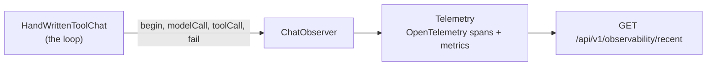

# Stage J8.4: observability, built several ways

Plan: [`docs/roadmap.md`](../roadmap.md) ("Stage J8"). Decisions: [ADR 0039](../adr/0039-observability-comparison.md). Code: [`comparisons/observability/`](../../comparisons/README.md) and the shared `comparisons/common` (`ChatObserver`, `Telemetry`). One section per approach, added as each is built: **J8.4a `handWritten`** (here), J8.4b `withSpringAi`, J8.4c `withLangchain4j`, and J8.4d the three side by side.

## In one minute

A backend that answers a question is a black box: you see the answer, not why it took four seconds, which model replied, how many tokens it cost or whether a tool failed. **Observability** is the flight recorder. Every question leaves a **trace** (a timeline of what happened, in steps called **spans**) and adds to **metrics** (running counts and timings). The rule that matters: the recorder writes down **what happened, never what was said**. No question, no answer, no document text goes into it.

| Shop idea | Project idea | Where |
| --- | --- | --- |
| A receipt for every customer: when, how long, which counter | **A trace**: one `chat.request` span for the question | `Telemetry.java` |
| A line on the receipt for each phone call to the supplier | **A `llm.generate` span** per model call, with the model and tokens | `Telemetry.java` |
| A line for each item fetched from the stockroom | **A `tool.<name>` span** per tool, with its outcome | `Telemetry.java` |
| The shop's daily tally sheet | **Metrics**: requests, model calls, tool calls, tokens, duration | `Telemetry.java` |

## J8.4a: observation by hand

The hand-written tool loop (J8.1a) with an observer. It is the same loop; at the points where it already holds the facts (the model's reply, a tool's result) it reports them. Port 18131.

**What is recorded** (ADR 0039): a root `chat.request` span; one `llm.generate` span per model call (model, input and output tokens, outcome); one `tool.<name>` span per tool the model asked for (outcome: `ran`, `invalid_call`, `invalid_arguments` or `tool_error`); and metrics for requests, model calls, tool calls, tokens and duration.

**The rules the code enforces** (each has a test):
- A question with one tool is one trace: a request, two model calls and one tool call, all children of the request.
- Tokens come from the model's own reply; the metrics add them up (a tool-call reply of 15 in and 6 out plus a text reply of 20 in and 8 out make 35 in and 14 out).
- A model that fails, or a missing key, makes a failed request (`cc.status=error`, `cc.failure=unavailable`), and a failed model call is an `error` outcome.
- Bad arguments, arguments that are not JSON and a tool that throws are each a tool span with its own outcome, not a `ran` tool.
- **A tool name the model made up is recorded as `unknown`**, never under its own name.
- **No content is ever recorded:** a test checks that the question, the answer, a tool result and the arguments appear nowhere in any span, metric or the JSON view.
- With observation off, nothing is recorded and the answer is the same.

**Measured here:** the signals the loop produces for scripted questions (a fake model and CRM), in OpenTelemetry's in-memory exporters. **Not measured:** a live model, real timings, export to Langfuse or another OTLP receiver.

**Rule to remember.** *Record what happened, never what was said. The question and the answer are the customer's, not the recorder's.*

## Code tour

| | Where | What |
| --- | --- | --- |
| new | `comparisons/common/.../ChatObserver.java`, `Telemetry.java`, `RecentSpans.java` | The contract, the one class that knows OpenTelemetry, a bounded span buffer |
| changed | `comparisons/common/.../ToolBackendServer.java` | An optional `Telemetry` and the `GET /api/v1/observability/recent` route |
| changed | `comparisons/tool-calling/handWritten/.../HandWrittenToolChat.java` | `withObserver(...)` and the reports where the loop holds the facts (off by default) |
| new | `comparisons/observability/handWritten/` | `ObservedHandWrittenMain` (port 18131) and the tests |
| new | `justfile` | `comparisons-observe-hand-written` |

## Questions to try

1. Ask one question that needs a tool. How many spans are in the trace, and which one is the parent?
2. Which of the three tool outcomes would you want to alert on, and why?
3. Why is a tool name the model invented recorded as `unknown`?
