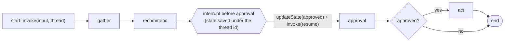
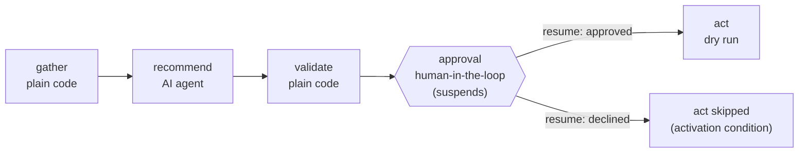

# Stage J8.5: a simple agent with an approval pause, built several ways

Plan: [`docs/roadmap.md`](../roadmap.md) ("Stage J8"). Decisions: [ADR 0042](../adr/0042-agent-with-approval-pause-comparison.md) (the contract). Code: [`comparisons/agent-graph/`](../../comparisons/README.md). One section per approach (J8.5a `handWritten`, J8.5b `withLangGraph4j`, J8.5c `withLangchain4jAgentic`) and, last, J8.5d, the three side by side. The per-approach decisions: [ADR 0043](../adr/0043-agent-with-langgraph4j.md), [ADR 0044](../adr/0044-agent-with-langchain4j-agentic.md). Spring AI has no graph or pause feature, so it has no folder here.

## In one minute

A chatbot answers. An **agent** *does* things in steps, and what makes it safe is a **pause**: before anything with side effects it stops and asks a person. Think of a junior clerk who prepares a refund, puts it in your tray and waits for your signature, instead of paying it out.

| Shop idea | Project idea | Where |
| --- | --- | --- |
| The clerk looks up the customer's file | **gather**: read the company's facts from the CRM (plain code) | `HandWrittenAgent.start` |
| The clerk writes a suggestion | **recommend**: one call to the model, which answers in a fixed JSON shape | `OpenRouterRecommender` |
| The suggestion goes in your tray | **approval**: the run is stored and the call returns; nothing happens until you answer | `HandWrittenAgent.start` ends here |
| You sign, or you don't | **resume** with approve or decline | `HandWrittenAgent.resume` |
| The clerk does the job | **act**: a **dry run** here: it says what it would do and writes nothing | `HandWrittenAgent.resume` |

## J8.5a: the agent by hand

No AI framework: four plain steps, a stored run for the pause, and a hand-written model call. Port 18141.

**The rules the code enforces** (each has a test):
- `start` runs `gather` and `recommend` and stops at the approval: the answer has status `awaiting_approval`, the four steps (`done`, `done`, `waiting`, `pending`) and the recommendation.
- Approving runs `act` as a **dry run** (the message says "Dry run ... Nothing was written") and **the CRM saw only reads**; declining skips it.
- A run can be answered **once**: a second answer is refused (409); an unknown run is refused (404).
- A company that is not in the CRM is a 404 and **the model is never asked**; a CRM that is down is a 503 and the model is never asked.
- The CRM facts reach the model **wrapped as untrusted data**; the model's answer must be JSON with an `action` of at most 200 characters, or the run fails (503); a code fence around the JSON is accepted.
- Errors say the HTTP status only, never what the service replied; no key means the model is never called.
- Only the most recent 100 runs are kept; two runs are independent.

**Measured here:** the behaviour of every step against a scripted model and a stub CRM. **Not measured:** a live model, and a durable pause (a restart forgets the runs).

**Rule to remember.** *An agent is safe because of what surrounds the model: fixed steps, the model's text confined to a message, and a pause before anything that matters.*

## J8.5b: the agent with LangGraph4j

The same four steps and the same HTTP contract, as a **LangGraph4j 1.9.9 graph**: `gather` (plain code), `recommend` (the same model call as the hand-written agent), `approval`, `act`. The pause is the library's own: the graph is compiled with a **checkpoint saver** and an **interrupt before `approval`**; a run is a graph *thread* whose id is the run id. Port 18142. Decisions and the measured tables: [ADR 0043](../adr/0043-agent-with-langgraph4j.md).

**What LangGraph4j gave, without a line of ours** (measured in `LangGraph4jBehaviourTests`): the stop and the saved state, the continue from the checkpoint with the answer put into the state, a conditional edge that reads that answer, independent threads, and a refusal to resume a finished thread.

**What it did not give, and what that took:**

| The rule | What LangGraph4j does | In `withLangGraph4j` |
| --- | --- | --- |
| Know that the run stopped | `invoke` returns the state so far, **no marker** | Ask the saver: `getState(...).nextNodeId()` |
| 404 unknown run, 409 answered run | The **same two exceptions** for both | Our map of runs and a status |
| Keep only the last 100 runs | The saver has **no bound and no way to forget a thread** | One graph and one saver **per run**, in a bounded map |
| The original error | Wrapped in **three layers** | `unwrap` |
| A failed run must not linger | It **stays saved at the failed node** | A run is kept only after it reached the pause |
| State | Must be **serializable** | Strings only |

**Two things you would not guess.** The nodes run on **the library's own platform thread**, not the caller's, so anything that depends on the calling thread (a request context) does not follow. And a **finished thread's checkpoints are kept** (moved into a tag) whatever the release setting, so a saver that serves many runs grows for ever.

**Cost.** One direct dependency (`langgraph4j-core`, about 320 KB, bringing `async-generator`, `gson`, `slf4j-api`, `jspecify` and Jackson 2). The agent class is **178 lines of code against 112** for the hand-written one: the library replaced the state machine with two calls, but the contract rules it does not give were written out.

**Measured here:** the library's behaviour and the agent's, against a scripted model and a stub CRM. **Not measured:** a live model, and a durable saver (the application's `langgraph4j-postgres-saver` is not used here).

**Rule to remember.** *A checkpoint is not a record of runs. The library keeps the state; knowing which runs exist, which are answered and how many to keep is still yours.*
## J8.5c: the agent with LangChain4j's agentic module

The same four-step agent with LangChain4j's **agentic** module (`langchain4j-agentic`, a **beta**, 1.23.0-beta33, mapped by the stable BOM): one **sequence** of five agents over a shared scope. Port 18143. Decisions and the measured tables: [ADR 0044](../adr/0044-agent-with-langchain4j-agentic.md).

**The answer to the key question: yes, its pause does not hold a thread.** The approval agent's response provider returns a `SuspendedResponse`: the library stops the sequence, **releases the calling thread** and returns a *suspended result* with a resume callback. `resume` completes the pending response and the library carries on from where it stopped (earlier steps do not run again). The other kind of response, a provider that waits on a future, **does** park the thread (measured), so the choice of response type decides.

**What the module gave for free:** the sequence and the shared scope, the suspension and the resume, the skip of a step by an activation condition, independent runs by memory id. **What had to be added:** the bounded run store with eviction (**the library keeps every scope in memory, finished runs too**), the 404 and 409 answers, status-only error text (the library wraps exceptions three deep), the key check, and the answers in the contract's fixed shape.

**Found by running it:** the agent interfaces must be **public** (the library calls them by reflection, and a package-private interface fails with `IllegalAccessException`).

**Measured here:** the library's behaviour and ours against a scripted model and a stub CRM. **Not measured:** a live model, a durable pause across a restart (the module has a scope store that was not used), the loop and supervisor workflows.

**Rule to remember.** *Ask a framework's pause two questions: does it hold a thread, and does it survive a restart? Here the answers are no, and not unless you add a store.*

## J8.5d: the three side by side

The same agent, the same HTTP contract and the same rules, built three ways. Everything here comes from the code, the tests and ADRs 0042 to 0044. **Spring AI has no graph or pause feature** (its documentation describes agent workflows as patterns you write with `ChatClient`), so it has no folder in this stage. **Not measured:** a live model, and a pause that survives a restart (all three keep their runs in memory), so nothing below says which path is faster or more reliable in production.

**Size.** Lines of Java that are not blank, not comments, not `import` or `package` lines. The shared pieces in `comparisons/common` (`Agent`, `AgentBackendServer`, `Recommender`, `OpenRouterRecommender`, **254 lines**) are used by all three and counted once:

| | handWritten | withLangGraph4j | withLangchain4jAgentic |
| --- | --- | --- | --- |
| **The agent class** | **112** | **178** | **242** |
| Module main code (agent class and its main) | 131 | 197 | 262 |
| Module test code | 258 | 438 | 433 |
| Test files | 2 | 3 | 3 |
| Library | none | `langgraph4j-core` (stable 1.9.9) | `langchain4j-agentic` (**beta**, 1.23.0-beta33) |

**Read this table carefully.** As in the observability stage, the hand-written path is the **smallest**, and the gap is wider the more the library has to be told. For **four fixed steps and one pause**, a graph is more code than a state machine: the library replaces the state machine itself (the pause and the resume become library calls), but the rules of the contract are written out anyway. The frameworks needed about 70% more test code, because each needed a class that measures what the library does on its own.

**How each one makes the pause** (the framework columns show what the library does on its own, measured):

| | handWritten | withLangGraph4j | withLangchain4jAgentic |
| --- | --- | --- | --- |
| **The pause** | A run object in a map with the status `awaiting_approval`; `start` simply returns | A checkpoint saver and a stop before the `act` node; `invoke` returns the state **with no marker that it stopped**, so we ask `getState(config).nextNodeId()` | A human-in-the-loop provider that returns a **`SuspendedResponse`: the thread is released** and the result says `suspended() == true` |
| Where the run's state lives | Our map | The library's `MemorySaver` (one per run) | The library's agentic scope, plus our map of suspended results |
| **Resuming** | Find the run, run `act` | Put the answer in the saved state (`updateState`), then `invoke` again | `completePendingResponse(value)`: continues **from where it stopped**, earlier steps do not run again |
| A thread held while waiting? | No | No | **No** (a provider that waits on a future would park a thread; that was measured, and is not used) |
| A finished or unknown run | Our map and status give the 409 and the 404 | **The same exception for both**: the library cannot tell which is which, so our map does | A second completion throws `IllegalStateException`; our status check gives the 409 first |
| **Memory** | A map that keeps the most recent 100 runs | **The saver has no bound and no way to forget a thread**: one graph and saver per run, in a bounded map | **Every scope stays in a registry**, finished ones too: we evict it ourselves |
| An exception in a step | Plain | Wrapped in **three layers**; the thread stays saved at the failed node | Wrapped (`AgentInvocationException` and others); found by walking the causes |
| Skipping `act` on a decline | An `if` | The end edge when the answer is not an approval (a resume with **no answer takes the end edge silently**) | An **activation condition** on the step |
| Quirks found by running it | none | State must be **serializable**; nodes run on the library's own **platform** thread | Agent interfaces must be **public** (reflection); a **beta** |

**The same lesson, three times.** The library gives you the stopping and the resuming. It does **not** give you a record of runs: the **404, the 409 and the memory bound came from our own map in all three**, because a checkpoint or a scope is state, not a list of runs someone may still answer. **A pause is only as safe as the code around it.** A durable pause (one that survives a restart) exists in LangGraph4j as a Postgres saver, which the application uses; this comparison does not use it.

**When to pick which** (a judgement from this exercise, not a measurement):
- **Hand-written** when the steps are few and fixed and the pause is one status: the code is the smallest and every rule is in one place. The cost: you own the state machine and the store.
- **LangGraph4j** when the agent has many steps, conditions and loops, or the pause must be durable (the Postgres saver). It is a stable library; plan for the run record and the memory bound.
- **LangChain4j agentic** when you already build on LangChain4j and want sequences of agents sharing one scope. Its human-in-the-loop can pause without holding a thread, but it is a beta: plan for API changes and the registry that only grows.
- In all three cases, **write the contract's rules first** (one answer per run, unknown run, a bound on memory, status-only errors) and test each against the library, including two runs at once.

**Rule to remember.** *A framework gives you the stopping and the resuming. The run record, the 404 and 409, and the memory bound are still yours.*

## Code tour

| | Where | What |
| --- | --- | --- |
| new | `comparisons/common/.../Agent.java`, `AgentBackendServer.java`, `Recommender.java`, `OpenRouterRecommender.java` | The contract, the shared HTTP face and the shared model call |
| new | `comparisons/agent-graph/handWritten/` | `HandWrittenAgent` (the steps, the run store, the resume), `HandWrittenAgentMain` (port 18141) |
| new | `justfile` | `comparisons-agent-hand-written` |
| new (J8.5b) | `comparisons/agent-graph/withLangGraph4j/` | `LangGraph4jAgent` (the graph, the run map), `LangGraph4jAgentMain` (port 18142); `justfile` `comparisons-agent-with-langgraph4j` |
| new (J8.5c) | `comparisons/agent-graph/withLangchain4jAgentic/` | `LangChain4jAgenticAgent` (the sequence, the run store, the resume), `LangChain4jAgenticMain` (port 18143); two members of `OpenRouterRecommender` made public; justfile `comparisons-agent-with-langchain4j-agentic` |

## Questions to try

1. Start a run and look at the steps. Where exactly is the run while it waits, and what happens to it if the backend restarts?
2. Why does the dry-run message echo the model's action instead of running it?
3. What would you have to add to make the pause survive a restart?
