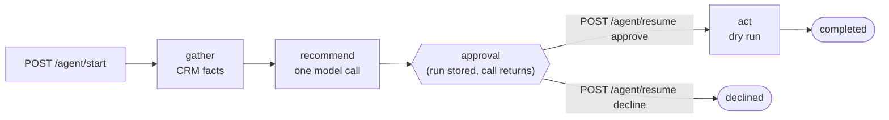

# Stage J8.5: a simple agent with an approval pause, built several ways

Plan: [`docs/roadmap.md`](../roadmap.md) ("Stage J8"). Decisions: [ADR 0042](../adr/0042-agent-with-approval-pause-comparison.md) (the contract). Code: [`comparisons/agent-graph/`](../../comparisons/README.md). One section per approach, added as each is built: **J8.5a `handWritten`** (here), J8.5b `withLangGraph4j`, J8.5c `withLangchain4jAgentic`, and J8.5d the three side by side. Spring AI has no graph or pause feature, so it has no folder here.

## In one minute

A chatbot answers. An **agent** *does* things in steps, and what makes it safe is a **pause**: before anything with side effects it stops and asks a person. Think of a junior clerk who prepares a refund, puts it in your tray and waits for your signature, instead of paying it out.

| Shop idea | Project idea | Where |
| --- | --- | --- |
| The clerk looks up the customer's file | **gather**: read the company's facts from the CRM (plain code) | `HandWrittenAgent.start` |
| The clerk writes a suggestion | **recommend**: one call to the model, which answers in a fixed JSON shape | `OpenRouterRecommender` |
| The suggestion goes in your tray | **approval**: the run is stored and the call returns; nothing happens until you answer | `HandWrittenAgent.start` ends here |
| You sign, or you don't | **resume** with approve or decline | `HandWrittenAgent.resume` |
| The clerk does the job | **act**: a **dry run** here: it says what it would do and writes nothing | `HandWrittenAgent.resume` |

## J8.5a: the agent by hand

No AI framework: four plain steps, a stored run for the pause, and a hand-written model call. Port 18141.

**The rules the code enforces** (each has a test):
- `start` runs `gather` and `recommend` and stops at the approval: the answer has status `awaiting_approval`, the four steps (`done`, `done`, `waiting`, `pending`) and the recommendation.
- Approving runs `act` as a **dry run** (the message says "Dry run ... Nothing was written") and **the CRM saw only reads**; declining skips it.
- A run can be answered **once**: a second answer is refused (409); an unknown run is refused (404).
- A company that is not in the CRM is a 404 and **the model is never asked**; a CRM that is down is a 503 and the model is never asked.
- The CRM facts reach the model **wrapped as untrusted data**; the model's answer must be JSON with an `action` of at most 200 characters, or the run fails (503); a code fence around the JSON is accepted.
- Errors say the HTTP status only, never what the service replied; no key means the model is never called.
- Only the most recent 100 runs are kept; two runs are independent.

**Measured here:** the behaviour of every step against a scripted model and a stub CRM. **Not measured:** a live model, and a durable pause (a restart forgets the runs).

**Rule to remember.** *An agent is safe because of what surrounds the model: fixed steps, the model's text confined to a message, and a pause before anything that matters.*

## Code tour

| | Where | What |
| --- | --- | --- |
| new | `comparisons/common/.../Agent.java`, `AgentBackendServer.java`, `Recommender.java`, `OpenRouterRecommender.java` | The contract, the shared HTTP face and the shared model call |
| new | `comparisons/agent-graph/handWritten/` | `HandWrittenAgent` (the steps, the run store, the resume), `HandWrittenAgentMain` (port 18141) |
| new | `justfile` | `comparisons-agent-hand-written` |

## Questions to try

1. Start a run and look at the steps. Where exactly is the run while it waits, and what happens to it if the backend restarts?
2. Why does the dry-run message echo the model's action instead of running it?
3. What would you have to add to make the pause survive a restart?
