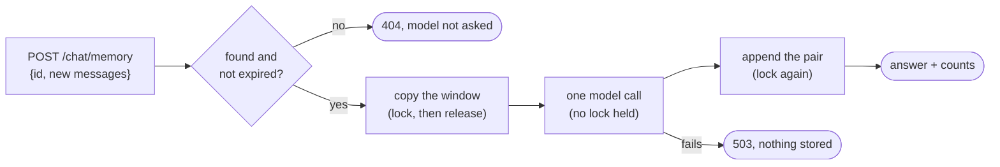

# Stage J8.6: conversation memory, built several ways

Plan: [`docs/roadmap.md`](../roadmap.md) ("Stage J8"). Decisions: [ADR 0050](../adr/0050-conversation-memory-comparison.md) (the contract and the hand-written path). Code: [`comparisons/memory/`](../../comparisons/README.md). One section per approach (J8.6a `handWritten`; `withSpringAi` and `withLangchain4j` follow) and, last, the three side by side.

## In one minute

A model has **no memory**: each request is a new meeting. To hold a conversation, someone must hand it the minutes of the last meeting every time. Think of a receptionist who keeps a folder per visitor: before each visit they take the last few pages out and put them in front of the doctor, and after the visit they file the new pages. The visitor only says "I'm back, folder 7".

| Shop idea | Project idea | Where |
| --- | --- | --- |
| A folder per visitor, with a number on it | a **conversation** with a random **id** | `HandWrittenMemoryChat.create` |
| The last few pages go to the doctor | the **window**: last 20 messages, at most 16,000 characters | `HandWrittenMemoryChat.window` |
| New pages are filed after the visit | the **turn** is stored only after the model answered | `HandWrittenMemoryChat.turn` |
| Folders not touched for a day are shredded | the **time limit**: 24 hours after the last use | `expired` |
| The cabinet holds 1,000 folders | the **cap**: the least recently used goes | `create` |
| The receptionist does not wait with the folder locked while the doctor thinks | **no lock across the model call** | `turn` |

## J8.6a: memory by hand

No AI framework: a map, two kinds of lock, a clock and a hand-written model call. Port 18161.

**The rules the code enforces** (each has a test):
- A turn stores the user message then the answer, and answers with `messagesUsed` (what the model saw from the past) and `messagesStored`.
- The history goes **before** the new messages, after the system message.
- A **failed** model call stores nothing; **no key** means no call and nothing stored.
- **Only the last 20** stored messages are sent; the oldest are dropped until the characters are at most 16,000 (exactly 16,000 is kept). All stay stored.
- A conversation expires **24 hours after its last use**: a turn extends it, a read does not; expired ones are removed when another is created.
- Creating beyond **1,000** removes the **least recently used**; using one protects it, reading does not.
- Delete is immediate; an unknown id is 404 and the model is not asked; two conversations never see each other.
- Two turns on one conversation at once each store their pair whole; **a turn blocked inside the model call does not block** reads, creates or deletes; a conversation deleted mid-turn stays deleted.
- Bad bodies are 422 before the model; errors never repeat an exception's own text; observation records counts, never text.

**Measured vs not measured.** Measured: every rule above, against a scripted model and a movable clock, plus a real start of the backend. **Not measured:** a live model, answer quality, token cost (they need the owner's go).

**Rule to remember:** **the model remembers nothing; whoever keeps the history decides what it sees, so the window, the time limit and the lock are your code's job.**

## Code tour

- Shared: `comparisons/common` has `MemoryChat` (the contract), `MemoryLimits`, `OpenRouterChat` and `MemoryChatBackendServer`.
- By hand: `comparisons/memory/handWritten/.../HandWrittenMemoryChat.java` (the store and the turn) and `HandWrittenMemoryMain.java` (start-up).
- Tests: `HandWrittenMemoryChatTests` (the rules), `ObservedAndServedTests` (HTTP and signals), with `FakeModel` and `MutableClock`.

## Questions to try

1. Tell it a name, ask for the name later: where does the second answer get it from? (look at `messagesUsed`)
2. Send 13 turns: how many past messages does the 13th use? Does `GET` still show them all?
3. Why does a read not extend the 24 hours, but a turn does?
4. What would break if the lock were held during the model call?
