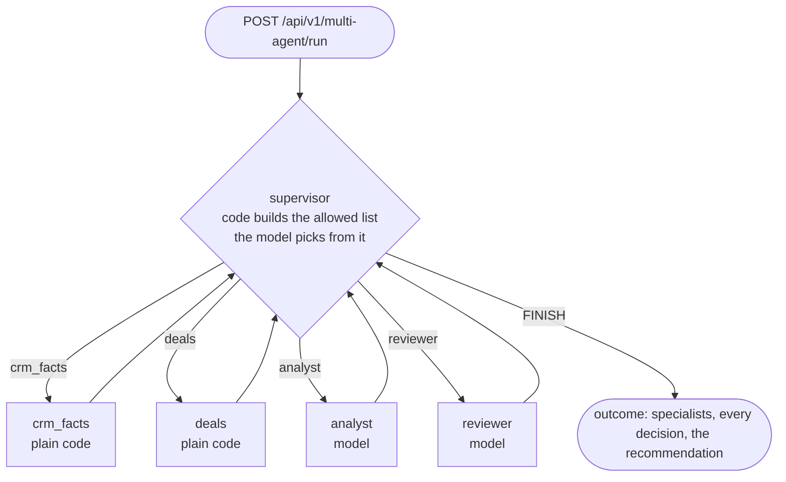

# Stage J8.7: multi-agent patterns and frameworks

Plan: [`docs/roadmap.md`](../roadmap.md) ("Stage J8"). Decisions: [ADR 0045](../adr/0045-multi-agent-patterns-on-langgraph4j.md). This page grows slice by slice: **J8.7a the verified survey** (here), then the patterns, then the write-up.

## In one minute

One agent that does a task is a clerk. **Several agents** are a team, and the interesting question is how the team is organised: **who decides who works next?** There are four common answers, called **architectural patterns**:

| Pattern | Who decides what happens next | Shop picture |
| --- | --- | --- |
| **Supervisor** | One coordinator, after each step | A manager who hands each job to a specialist and gets it back |
| **Hierarchical** | Supervisors of supervisors | A manager of managers: a research department and an answer department, each with its own manager |
| **Network** | Any agent may call any other; no one is in charge | A group chat of specialists |
| **Handoff / swarm** | Each agent passes the customer on to the next, by name | A relay: "I can't help with that, let me pass you to billing" |

A pipeline (fixed order in code) and a parallel fan-out are simpler cousins. The rule of thumb from the sources: **if you can write the plan up front, use a pipeline; use a supervisor only when the next step depends on results.**

## The decisions (ADR 0045)

- **No hand-written path in J8.7.** The hand-written baseline taught the same lesson in J8.1 to J8.5 (the rules are yours, in every path), and the application's own supervisor (ADR 0020, stage E3) is the framework-based reference.
- **Axis A, the four patterns on one framework: LangGraph4j.** One graph engine that can express all four keeps the comparison about the *architecture*, not the library. The model calls inside the nodes can use **Spring AI** (see below).
- **Frameworks only as a survey (this page)**, not as built paths, unless the owner asks later.

## J8.7a: the survey

**Method and date.** Everything below was read on **2026-11-17** from primary sources: Maven Central (latest versions and dates), each project's GitHub (licence, stars, last push, releases), and each project's own README and documentation pages. A claim that I could not confirm from those is marked **not verified**. Blogs were only used to find what to check.

### Frameworks, verified

| Framework | Latest release (Maven Central) | GitHub | Notes |
| --- | --- | --- | --- |
| **LangGraph4j** | core **1.9.9** (2026-11-07) | MIT, 2.1k stars, last push 2026-11-16; the latest GitHub release shown is **v1.8.28** (2026-11-13), so **two release lines appear to exist**: check before upgrading | Graphs with state; conditional edges; child graphs (subgraphs); parallel branches; threads; **checkpoint savers** for memory, filesystem, **Postgres**, MySQL, Redis, MongoDB, Oracle, SQLite, DynamoDB and more; an **OpenTelemetry** module (1.9.9) that wraps nodes and edges in spans; **Spring AI and LangChain4j integrations** |
| **LangChain4j** | 1.23.0 (2026-10-28); the **agentic module is 1.23.0-beta33, a beta** | Apache-2.0, 13.4k stars, last push 2026-11-17 | Agentic: sequential, loop, parallel and conditional workflows, and a planner-based agent (measured in J8.5) |
| **Spring AI** | GA **2.0.2** (2026-10-23, the release we use); 2.1.0-RC2 also published | Apache-2.0, 9.7k stars, last push 2026-11-15 | The model, tools, memory and vector-store layer; documents agent **patterns as code**, not a runtime (see below) |
| **Embabel** | **1.5.4** (2026-10-28) | Apache-2.0, 4.6k stars, last push 2026-11-17 | Written in Kotlin, usable from Java. Agents declare **goals, conditions and actions**; **the plan is formed by the system, not the programmer** (a planning step, not a model choosing each step) |
| **Google ADK for Java** | **1.14.0** (2026-11-02) | Apache-2.0, 1.8k stars, last push 2026-11-17 | README: composing agents "into flexible hierarchies"; an **A2A** (agent-to-agent protocol) integration |
| **Koog** (JetBrains) | 1.3.0 (2026-09-23) | Apache-2.0, 4.7k stars, last push 2026-11-10 | Kotlin-based, graph workflows |

**Corrections to what I reported earlier from blogs:** Google ADK for Java is at **1.14.0**, not "1.0"; Embabel is at **1.5.4**; the exact date a blog gave for Spring AI 2.0 going GA is **not verified** (Spring AI 2.0.2 is GA and published 2026-10-23).

### The four patterns, in each project's own documentation

| Pattern | LangGraph4j | LangChain4j agentic | Spring AI | Embabel | ADK for Java | Koog |
| --- | --- | --- | --- | --- | --- | --- |
| **Supervisor** | Conditional edges route to the next node (README); our application's supervisor is built this way | A planner-based agent over sub-agents (docs show a `PlannerAgent`) | **Orchestrator-Workers and Routing**, documented as code samples | Planning replaces the supervisor: not verified how it maps | Hierarchies of agents (README); how a parent delegates: **not verified** | Not verified |
| **Hierarchical** | **Child graphs (subgraphs)** nested inside a node (README) | Not verified | Not documented | Not verified | **Yes: "flexible hierarchies"** (README) | Not verified |
| **Network** | Any edges between nodes are possible; **not documented as a named pattern** | Not verified | Not documented | Not verified | Not verified | Not verified |
| **Handoff / swarm** | Separate modules `langgraph4j-springai-agent-handoff` and `langgraph4j-lc4j-agent-handoff`, **but both at 1.5.12 while the core is 1.9.9**: possibly not maintained in step | Not verified | Not documented | Not verified | Not verified | Not verified |
| Sequential, parallel, loop | Parallel branches (README) | **Sequential, loop, parallel, conditional** (docs) | **Chain, Parallelization, Evaluator-Optimizer** (docs) | A plan can sequence actions | Not verified | Graph workflows |

**How to read "not verified":** the README or the page I could read did not say. The ADK and Embabel documentation sites did not load as text, so I read their READMEs. These cells are for the build or a follow-up to settle.

### Spring AI and the four patterns

Spring AI's own documentation ("Building Effective Agents") lists five patterns: **Chain, Parallelization, Routing, Orchestrator-Workers and Evaluator-Optimizer**, each as a **workflow written in code with `ChatClient`**: predefined code paths, with no runtime that holds state, loops with limits, pauses, or checkpoints. So:

- **Spring AI is not an orchestration engine.** Orchestrator-Workers and Routing are the closest to a supervisor, and you write the loop, the limits and the state yourself. **Hierarchical, network and handoff are not documented as Spring AI features.**
- **Spring AI is the model and tool layer, and it is used inside the engine.** LangGraph4j publishes `langgraph4j-spring-ai` (1.9.9: streaming chat, tool-execution helpers and message serializers) and an agent executor on Spring AI's `ChatModel` with tool callbacks, **approval gates and sub-agents**. The layering the sources describe, **a model layer (Spring AI or LangChain4j) under an orchestration layer (LangGraph4j, Embabel, ADK)**, is what J8.7 will use: LangGraph4j for the pattern, Spring AI for the model calls.

## J8.7b: the supervisor pattern

Code: `comparisons/multi-agent/supervisor/withLangGraph4jSpringAi` (port 18151). Decisions and the measured tables: [ADR 0046](../adr/0046-supervisor-on-langgraph4j-with-spring-ai.md). The folder name says the concept, the pattern and the framework: **LangGraph4j** runs the graph, **Spring AI** makes the model calls.

**The picture.** A manager who hands each job to a specialist and gets it back. After every job the manager looks at the state and decides who is next, but **the rule book (which specialists may be called now) is code**, and the manager (a model) only picks from the list that code gives. When only one specialist is allowed, nobody is asked.

| State | Allowed this turn |
| --- | --- |
| Facts not loaded | `crm_facts` |
| Company not found | `FINISH` (the run ends as a 404) |
| Facts loaded, no recommendation | `deals` (if fewer than 2 lookups), `analyst` |
| A recommendation, not reviewed | `reviewer` |
| Approved, or one revision already used | `FINISH` |
| Reviewed and sent back, a revision left | `analyst`, `deals` (if fewer than 2 lookups) |

**The rules the code enforces** (each has a test):
- **No model call when there is no choice;** the decision is recorded as `decidedBy: code`.
- **An unreadable or disallowed answer is replaced by the first allowed entry** and recorded with what the model proposed (a plain word, or `unreadable`: model text is never echoed).
- **The supervisor's prompt holds no CRM text,** only flags and the allowed list, so text in the data cannot steer the routing; the analyst and the reviewer see the facts wrapped as untrusted data.
- **At most 10 turns** (then status `stopped`), at most 2 deals lookups, at most 1 revision; an unreadable review counts as a request to revise.
- Errors say the status only; no key means no model call; **no content is ever recorded** in the signals (a span per decision and per specialist, tokens, outcomes).

**What the libraries gave, and what was added** (measured; the full tables are in the ADR):
- LangGraph4j **stops a looping graph at its own limit of 25 iterations**, reports a conditional edge with an unmapped key as a `GraphRunnerException`, wraps a node's exception in three layers and runs nodes on its own platform thread.
- Spring AI's response carries the tokens and the answering model, but **its HTTP error message holds the service's own reply**.
- **Neither library gives the rules:** the allowed lists, the turn limit, the 404, the status-only errors and the never-content signals were added by us.

**Measured here:** the routing, the limits and the failures against a scripted model and a stub CRM. **Not measured:** a live model, real latencies and cost.

**Rule to remember.** *The model proposes, code decides: the supervisor is only as safe as the allowed list around it.*

## The plan

| Slice | What | ETA |
| --- | --- | --- |
| **J8.7a** (this PR) | The verified survey, ADR 0045, the roadmap updated | done |
| **J8.7b** | A shared scenario and contract; the **supervisor** pattern on LangGraph4j with Spring AI's chat model in the nodes | 80 to 100 min |
| **J8.7c to e** | **Hierarchical** (subgraphs), **network** (peer agents) and **handoff** (agents name the next one), in parallel | 60 to 80 min each, in parallel |
| **J8.7f** | The write-up: the four patterns side by side (size, control, cost, failure modes) and the production recommendations | 25 min |

The same scenario in every pattern (the account review: facts, an analysis, a review, a recommendation), the same limits (turn cap, caps per specialist), the decisions recorded as data, and the J8.4 telemetry sink (a span per specialist and per decision, never content) so the four patterns can be compared on the same signals.

## Production recommendations (from J8.1 to J8.5 and the survey)

1. **Simplest topology that works:** pipeline before supervisor.
2. **The model proposes, code decides:** allowed lists and preconditions are code.
3. **Typed, validated hand-offs at every boundary** (our recommendation is parsed and length-checked).
4. **Hard limits:** maximum turns, caps per specialist, timeouts, a cost budget per run.
5. **Human approval before side effects** (J8.5).
6. **Trace every decision, never the content** (J8.4; LangGraph4j also has an OpenTelemetry module for nodes and edges).
7. **Evals with recorded runs** (record, replay, baseline).
8. **A run record and a memory bound are yours,** whatever the library (the J8.5 finding).
9. **Durable state for long runs:** LangGraph4j's Postgres saver (not used in the comparisons).
10. **Interop:** MCP for tools (built in the application); A2A for calls between frameworks (in ADK's README; not built here).

## Not verified, to settle in the build or a follow-up

- How LangChain4j agentic expresses hierarchy and handoff; how ADK delegates between agents; how Embabel's planning maps to a supervisor; Koog's multi-agent support.
- Whether the LangGraph4j 1.8.x and 1.9.x lines both matter, and whether the 1.5.12 handoff modules work with 1.9.9.
- Costs and latencies of any pattern: nothing here was run against a live model.
