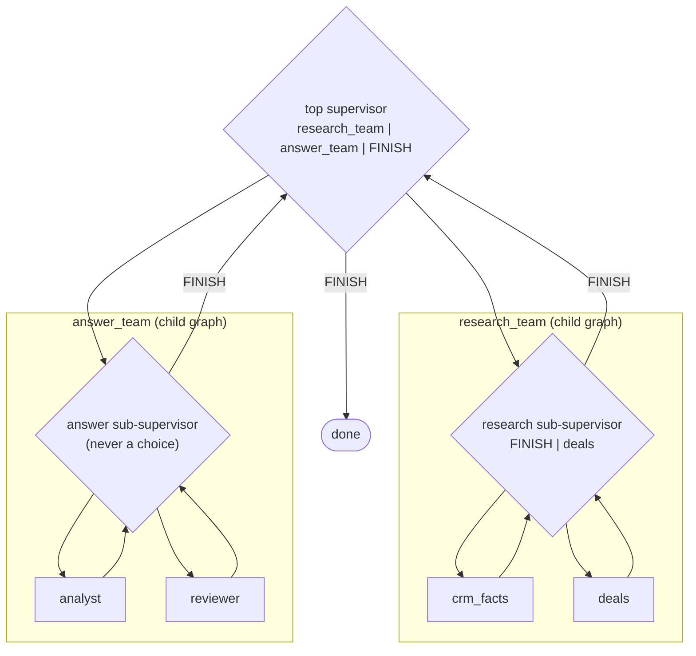
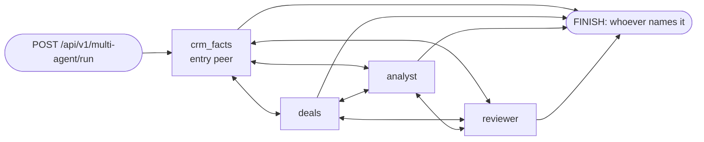
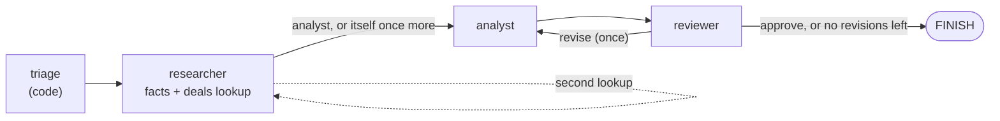

# Stage J8.7: multi-agent patterns and frameworks

Plan: [`docs/roadmap.md`](../roadmap.md) ("Stage J8"). Decisions: [ADR 0045](../adr/0045-multi-agent-patterns-on-langgraph4j.md). This page grows slice by slice: **J8.7a the verified survey**, the four patterns (**J8.7b** supervisor, **J8.7c** hierarchical, **J8.7d** network, **J8.7e** handoff, ADRs [0046](../adr/0046-supervisor-on-langgraph4j-with-spring-ai.md) to [0049](../adr/0049-handoff-pattern-on-langgraph4j-with-spring-ai.md)) and **J8.7f**, the four side by side.

## In one minute

One agent that does a task is a clerk. **Several agents** are a team, and the interesting question is how the team is organised: **who decides who works next?** There are four common answers, called **architectural patterns**:

| Pattern | Who decides what happens next | Shop picture |
| --- | --- | --- |
| **Supervisor** | One coordinator, after each step | A manager who hands each job to a specialist and gets it back |
| **Hierarchical** | Supervisors of supervisors | A manager of managers: a research department and an answer department, each with its own manager |
| **Network** | Any agent may call any other; no one is in charge | A group chat of specialists |
| **Handoff / swarm** | Each agent passes the customer on to the next, by name | A relay: "I can't help with that, let me pass you to billing" |

A pipeline (fixed order in code) and a parallel fan-out are simpler cousins. The rule of thumb from the sources: **if you can write the plan up front, use a pipeline; use a supervisor only when the next step depends on results.**

## The decisions (ADR 0045)

- **No hand-written path in J8.7.** The hand-written baseline taught the same lesson in J8.1 to J8.5 (the rules are yours, in every path), and the application's own supervisor (ADR 0020, stage E3) is the framework-based reference.
- **Axis A, the four patterns on one framework: LangGraph4j.** One graph engine that can express all four keeps the comparison about the *architecture*, not the library. The model calls inside the nodes can use **Spring AI** (see below).
- **Frameworks only as a survey (this page)**, not as built paths, unless the owner asks later.

## J8.7a: the survey

**Method and date.** Everything below was read on **2026-11-17** from primary sources: Maven Central (latest versions and dates), each project's GitHub (licence, stars, last push, releases), and each project's own README and documentation pages. A claim that I could not confirm from those is marked **not verified**. Blogs were only used to find what to check.

### Frameworks, verified

| Framework | Latest release (Maven Central) | GitHub | Notes |
| --- | --- | --- | --- |
| **LangGraph4j** | core **1.9.9** (2026-11-07) | MIT, 2.1k stars, last push 2026-11-16; the latest GitHub release shown is **v1.8.28** (2026-11-13), so **two release lines appear to exist**: check before upgrading | Graphs with state; conditional edges; child graphs (subgraphs); parallel branches; threads; **checkpoint savers** for memory, filesystem, **Postgres**, MySQL, Redis, MongoDB, Oracle, SQLite, DynamoDB and more; an **OpenTelemetry** module (1.9.9) that wraps nodes and edges in spans; **Spring AI and LangChain4j integrations** |
| **LangChain4j** | 1.23.0 (2026-10-28); the **agentic module is 1.23.0-beta33, a beta** | Apache-2.0, 13.4k stars, last push 2026-11-17 | Agentic: sequential, loop, parallel and conditional workflows, and a planner-based agent (measured in J8.5) |
| **Spring AI** | GA **2.0.2** (2026-10-23, the release we use); 2.1.0-RC2 also published | Apache-2.0, 9.7k stars, last push 2026-11-15 | The model, tools, memory and vector-store layer; documents agent **patterns as code**, not a runtime (see below) |
| **Embabel** | **1.5.4** (2026-10-28) | Apache-2.0, 4.6k stars, last push 2026-11-17 | Written in Kotlin, usable from Java. Agents declare **goals, conditions and actions**; **the plan is formed by the system, not the programmer** (a planning step, not a model choosing each step) |
| **Google ADK for Java** | **1.14.0** (2026-11-02) | Apache-2.0, 1.8k stars, last push 2026-11-17 | README: composing agents "into flexible hierarchies"; an **A2A** (agent-to-agent protocol) integration |
| **Koog** (JetBrains) | 1.3.0 (2026-09-23) | Apache-2.0, 4.7k stars, last push 2026-11-10 | Kotlin-based, graph workflows |

**Corrections to what I reported earlier from blogs:** Google ADK for Java is at **1.14.0**, not "1.0"; Embabel is at **1.5.4**; the exact date a blog gave for Spring AI 2.0 going GA is **not verified** (Spring AI 2.0.2 is GA and published 2026-10-23).

### The four patterns, in each project's own documentation

| Pattern | LangGraph4j | LangChain4j agentic | Spring AI | Embabel | ADK for Java | Koog |
| --- | --- | --- | --- | --- | --- | --- |
| **Supervisor** | Conditional edges route to the next node (README); our application's supervisor is built this way | A planner-based agent over sub-agents (docs show a `PlannerAgent`) | **Orchestrator-Workers and Routing**, documented as code samples | Planning replaces the supervisor: not verified how it maps | Hierarchies of agents (README); how a parent delegates: **not verified** | Not verified |
| **Hierarchical** | **Child graphs (subgraphs)** nested inside a node (README) | Not verified | Not documented | Not verified | **Yes: "flexible hierarchies"** (README) | Not verified |
| **Network** | Any edges between nodes are possible; **not documented as a named pattern** | Not verified | Not documented | Not verified | Not verified | Not verified |
| **Handoff / swarm** | Separate modules `langgraph4j-springai-agent-handoff` and `langgraph4j-lc4j-agent-handoff`, **but both at 1.5.12 while the core is 1.9.9**: possibly not maintained in step | Not verified | Not documented | Not verified | Not verified | Not verified |
| Sequential, parallel, loop | Parallel branches (README) | **Sequential, loop, parallel, conditional** (docs) | **Chain, Parallelization, Evaluator-Optimizer** (docs) | A plan can sequence actions | Not verified | Graph workflows |

**How to read "not verified":** the README or the page I could read did not say. The ADK and Embabel documentation sites did not load as text, so I read their READMEs. These cells are for the build or a follow-up to settle.

### Spring AI and the four patterns

Spring AI's own documentation ("Building Effective Agents") lists five patterns: **Chain, Parallelization, Routing, Orchestrator-Workers and Evaluator-Optimizer**, each as a **workflow written in code with `ChatClient`**: predefined code paths, with no runtime that holds state, loops with limits, pauses, or checkpoints. So:

- **Spring AI is not an orchestration engine.** Orchestrator-Workers and Routing are the closest to a supervisor, and you write the loop, the limits and the state yourself. **Hierarchical, network and handoff are not documented as Spring AI features.**
- **Spring AI is the model and tool layer, and it is used inside the engine.** LangGraph4j publishes `langgraph4j-spring-ai` (1.9.9: streaming chat, tool-execution helpers and message serializers) and an agent executor on Spring AI's `ChatModel` with tool callbacks, **approval gates and sub-agents**. The layering the sources describe, **a model layer (Spring AI or LangChain4j) under an orchestration layer (LangGraph4j, Embabel, ADK)**, is what J8.7 will use: LangGraph4j for the pattern, Spring AI for the model calls.

## J8.7b: the supervisor pattern

Code: `comparisons/multi-agent/supervisor/withLangGraph4jSpringAi` (port 18151). Decisions and the measured tables: [ADR 0046](../adr/0046-supervisor-on-langgraph4j-with-spring-ai.md). The folder name says the concept, the pattern and the framework: **LangGraph4j** runs the graph, **Spring AI** makes the model calls.

**The picture.** A manager who hands each job to a specialist and gets it back. After every job the manager looks at the state and decides who is next, but **the rule book (which specialists may be called now) is code**, and the manager (a model) only picks from the list that code gives. When only one specialist is allowed, nobody is asked.

| State | Allowed this turn |
| --- | --- |
| Facts not loaded | `crm_facts` |
| Company not found | `FINISH` (the run ends as a 404) |
| Facts loaded, no recommendation | `deals` (if fewer than 2 lookups), `analyst` |
| A recommendation, not reviewed | `reviewer` |
| Approved, or one revision already used | `FINISH` |
| Reviewed and sent back, a revision left | `analyst`, `deals` (if fewer than 2 lookups) |

**The rules the code enforces** (each has a test):
- **No model call when there is no choice;** the decision is recorded as `decidedBy: code`.
- **An unreadable or disallowed answer is replaced by the first allowed entry** and recorded with what the model proposed (a plain word, or `unreadable`: model text is never echoed).
- **The supervisor's prompt holds no CRM text,** only flags and the allowed list, so text in the data cannot steer the routing; the analyst and the reviewer see the facts wrapped as untrusted data.
- **At most 10 turns** (then status `stopped`), at most 2 deals lookups, at most 1 revision; an unreadable review counts as a request to revise.
- Errors say the status only; no key means no model call; **no content is ever recorded** in the signals (a span per decision and per specialist, tokens, outcomes).

**What the libraries gave, and what was added** (measured; the full tables are in the ADR):
- LangGraph4j **stops a looping graph at its own limit of 25 iterations**, reports a conditional edge with an unmapped key as a `GraphRunnerException`, wraps a node's exception in three layers and runs nodes on its own platform thread.
- Spring AI's response carries the tokens and the answering model, but **its HTTP error message holds the service's own reply**.
- **Neither library gives the rules:** the allowed lists, the turn limit, the 404, the status-only errors and the never-content signals were added by us.

**Measured here:** the routing, the limits and the failures against a scripted model and a stub CRM. **Not measured:** a live model, real latencies and cost.

**Rule to remember.** *The model proposes, code decides: the supervisor is only as safe as the allowed list around it.*

## J8.7c: the hierarchical pattern

Supervisors of supervisors. The same account review and the same four specialists as the supervisor pattern, organised in **two teams**: a top supervisor chooses between them, and each team is a LangGraph4j **child graph** with a sub-supervisor of its own. Port 18152; decisions: [ADR 0047](../adr/0047-hierarchical-pattern-on-langgraph4j-with-spring-ai.md); code: `comparisons/multi-agent/hierarchical/withLangGraph4jSpringAi`.

**The allowed lists, by level** (code builds them; the first entry is the fallback):

| Level | State | Allowed |
| --- | --- | --- |
| Top | no research yet | `research_team` |
| Top | researched, no answer yet | `answer_team`, and `research_team` once more if fewer than 2 lookups and fewer than 2 rounds |
| Top | answer done, or company not found | `FINISH` |
| Research team | facts not loaded | `crm_facts` |
| Research team | facts loaded | `FINISH`, and `deals` while fewer than 2 lookups |
| Answer team | no recommendation | `analyst` |
| Answer team | not reviewed | `reviewer` |
| Answer team | approved, or one revision used | `FINISH` |
| Answer team | review asked for a revision | `analyst` |

**What crosses a team boundary** is the graph's state, a bundle of plain strings, numbers and booleans (facts, deals, the recommendation, the review, counters): a child is given the parent's whole state, and its final state is merged back, **the child's value winning on a collision**. That is why each level has its own "who is next" key.

**What the extra level costs** (the same scripted happy path, measured):

| | Supervisor | Hierarchical |
| --- | --- | --- |
| Decisions | 5 | **9** (3 + 3 + 3) |
| Model calls | 4 | **5** (3 for routing: 2 in the research team, 1 at the top, none in the answer team) |
| Graphs | 1 | 3 |

Three of the four extra decisions are made by code: here the second level is a fixed order. **A hierarchy pays off when each level has real choices or when teams are owned separately; for fixed phases it is a pipeline with more bookkeeping.**

**Measured about LangGraph4j child graphs:** the child gets the parent's whole state; the library's limit of 25 iterations is **per graph**, and a child team counts as **one node** of the parent; a node's exception inside a child arrives with the same layers as a direct one; nodes run on the library's own platform threads.

**Rules, each tested:** the model chooses only from the allowed list; no model call when there is one option; an unreadable or disallowed answer is replaced and recorded; **no CRM text in any supervisor prompt at any level**; a team's turn limit ends the team (the run is marked `stopped`), the top has a limit, and 12 specialist runs is the last net; company not found is a 404 with no model call; errors by status only; no content in any signal.

**Not measured:** a live model, real latencies, the cost in money; information lost at a boundary (the bundle here carries everything whole).
## J8.7d: the network pattern

Code: `comparisons/multi-agent/network/withLangGraph4jSpringAi` (port 18153). Decisions and the measured tables: [ADR 0048](../adr/0048-network-pattern-on-langgraph4j-with-spring-ai.md). The folder name says the concept (multi-agent), the pattern (network) and the framework (LangGraph4j for the graph, Spring AI for the model calls). The same scenario and the same four specialists as the supervisor.

**The picture.** A group chat of specialists with **no manager**. When a peer has done its part, *it* says who should go next, and it may pick anyone, itself included. Nobody builds a list of who is allowed; each peer only checks that it has what it needs, and a few blunt limits stop the chat from running away.

| | Supervisor (J8.7b) | Network (J8.7d) |
| --- | --- | --- |
| Who decides who works next | One supervisor, after every specialist | Each peer, after its own work |
| What limits the choice | **An allowed list built by code from the state** | Only the peer's own inputs, a cap of turns, a cap of calls per peer and a loop guard |
| When is a model asked | Only if more than one specialist is allowed | After every peer's turn, except when the choice is forced |
| Where is the decision log | One place | Scattered over four peers |
| Who checks the job is done | The allowed list: FINISH only after approval or the last revision | **Nobody** |

**What was measured** (the numbers are asserted by tests, a scripted model): the happy path costs **6 model calls against 4 for the supervisor** (every peer decides); a peer that names itself is caught after **3 turns**; two peers naming each other with nothing new, after **4**; and a pair that keeps changing the board (the analyst and a reviewer who always asks for a revision) **slips past the loop guard** and is stopped only by the cap of 3 calls per peer, after **7 turns and 13 model calls**. A peer called out of order (the reviewer with nothing to review) costs one wasted turn and no model call. A peer may name FINISH too early, and the run ends `stopped`: no one checks the job.

**What the libraries gave, and what was added** (full tables in the ADR): a fully connected graph is just one conditional edge from every node to every node; **the library's only brake is its limit of 25 iterations**, after 24 turns, with no notion of a loop; the exception layers and Spring AI's error text are handled as in the supervisor. **Everything that keeps a network from wandering (the peers' own checks, the caps, the loop guard, the defaults for a bad answer) was added by us**, and the guards stay blunt.

**Measured here:** the routing, the guards and the failures against a scripted model and a stub CRM. **Not measured:** a live model, real latencies and cost in money.

**Rule to remember.** *A network trades control for freedom: it costs more calls, leaves no single decision log, and stops only where you drew a line.*
## J8.7e: the handoff pattern

Decisions and measurements: [ADR 0049](../adr/0049-handoff-pattern-on-langgraph4j-with-spring-ai.md). Code: `comparisons/multi-agent/handoff/withLangGraph4jSpringAi` (port 18154).

**The idea.** There is **no supervisor**. Each agent works, then **names the next agent** from **its own list**, and control passes on: a relay, not a manager. The agent that receives the work owns the next decision. The lists are code; the model may only pick from them.

| Agent | May hand off to | Who decides |
| --- | --- | --- |
| `triage` | `researcher` | code (one entry) |
| `researcher` | `analyst`, and `researcher` while fewer than two lookups were done | the **researcher itself**, by a model call in which each target is a tool (`transfer_to_analyst`); code when there is one entry |
| `analyst` | `reviewer` | code |
| `reviewer` | `analyst` (once), otherwise `FINISH` | the reviewer's own verdict |

**What was measured.** Through a Spring AI `ChatClient` an offered tool is **run** and the model is **asked again** (two requests); on the **ChatModel directly** the tool call comes back **unexecuted**, with its reason and token usage, in one request. Spring AI 2.0.2 has **no switch** to turn its own tool execution off. A model may answer in text, call a tool that was never offered, or call several, so the answer is **checked against the list**; one that is not on it is replaced by the first entry and recorded. LangGraph4j's published **handoff modules** stop at 1.5.12 (May 2025) while the core is 1.9.9; they were not used.

**Cost against the supervisor, for the same scripted scenario:** 3 model calls against 4 when the researcher does a second lookup, and 3 against 3 when the analyst follows straight away. One scenario, no live model.

**The same limits as the other patterns, in other words:** at most 10 handoffs, at most 3 visits to one agent, a repeated pair of agents is a loop; every run that hits one ends with status `stopped` and a recorded reason. The routing prompts never contain CRM text.

**When handoff fits.** Triage and routing to specialists, customer-facing flows. **When it does not:** a rule that must hold across the whole run, which a supervisor enforces in one allowed-list function and a handoff team spreads over the lists and the shared state.

## J8.7f: the four patterns side by side

The same scenario (the account review), the same four pieces of work, the same model layer (Spring AI), the same graph engine (LangGraph4j 1.9.9) and the same telemetry, organised four ways. Everything here comes from the code, the tests and ADRs 0046 to 0049. **Not measured:** a live model (whether it routes sensibly), real latencies, and cost in money, so the numbers below are counts from scripted runs, not general results.

**Size.** Lines of Java that are not blank, not comments, not `import` or `package` lines, in each pattern's folder (`comparisons/common` is shared and not counted). Each folder holds its own copy of the model layer and the four pieces of work, on purpose, so one folder reads on its own:

| | Supervisor | Hierarchical | Network | Handoff |
| --- | --- | --- | --- | --- |
| **The team class** (the pattern itself) | **282** | **350** | **330** | **308** |
| Module main code | 435 | 552 | 497 | 516 |
| Module test code | 638 | 783 | 708 | 662 |

The patterns differ by tens of lines, not by an order of magnitude. **The pattern is a small part of the code; the rules around it are most of it.**

**How each is organised, and what it costs** (counts from the same scripted happy path: facts, one deals lookup, analysis, review):

| | Supervisor | Hierarchical | Network | Handoff |
| --- | --- | --- | --- | --- |
| **Who decides what is next** | One coordinator model, from a list **code** builds | A top coordinator, then one per team | **Every peer**, any other peer | **The agent that just worked**, from **its own** list |
| **Model calls** | **4** (2 routing) | **5** (3 routing) | **6** (4 namings) | **3** (1 handoff) |
| **Where the rules live** | One allowed-list function | One per level | Nowhere central: each peer checks its own inputs | The union of the agents' lists |
| **The decision log** | One place, audited as a whole | One place, with the level in each entry | **Scattered over four peers** | Spread, but **auditable through the lists** |
| **Loops** | Bounded: a turn cap, one revision, two lookups | Bounded per level and in total | **Not bounded by design:** a runaway needs guards | Bounded by construction: a handoff cap, visits per agent |
| **Graphs** | 1 | 3 (the top and two child graphs) | 1, fully connected | 1 |

**What the tests measured about the failure modes**
- **Network:** a peer that names itself is stopped after 3 turns by the loop guard; two peers naming each other, after 4; but **an analyst and a reviewer that keep changing the board slip past the loop guard**, and only a per-peer cap stopped them, after **7 turns and 13 model calls**. A peer that names FINISH too early ends the run with no recommendation: **nothing checks the job.**
- **Hierarchical:** one more level means **four more decisions and one more model call** for the same review; three of the four extra decisions were made by code because the answer team's order is fixed. **The hierarchy pays off only when each level has a real choice.**
- **Handoff:** fewer routing questions, because each agent has few places to go; but **a rule that spans the whole run** (never draft before a review) is the union of lists and limits, where a supervisor has one function.
- **Supervisor:** the simplest to audit and to bound; every routing decision, its allowed list and any override is in one log.

**What the libraries gave, in all four patterns.** LangGraph4j: nodes, edges, conditional edges, child graphs, and an outer limit of **25 iterations**; it wraps a node's exception in several layers and runs nodes on its own platform threads. Spring AI: the model call with the token usage and the answering model, and (read directly from the ChatModel, because the ChatClient would execute the tool) a tool call that comes back unexecuted, which is how the handoff is read. **Neither gave any of the rules:** the allowed lists, the caps, the loop detection, the 404, the status-only errors, the recorded decisions and the never-content telemetry were **written by us in every pattern**. The choice of pattern changes the organisation, not who owns the rules.

**When to pick which** (a judgement from this exercise and the sources, not a measurement):
- **Start with a pipeline** (a fixed order in code). Move to a pattern only when the next step really depends on results.
- **Supervisor** is the default for a team with a real choice at each step: one place to enforce rules and one log to audit. It is also the one the application runs (E3).
- **Handoff** fits triage and routing to specialists, where the next owner of the conversation is a natural decision and each agent knows its neighbours.
- **Hierarchical** only when there are real teams with their own choices inside each team; otherwise the extra level is cost without benefit.
- **Network** only for a few symmetric peers doing exploratory work where a wandering run is cheap; it is **rare in production** because of the missing central control, the scattered log and the loops.
- In every case: **write the allowed lists, the caps and the never-content rule first**, test each against the library with a scripted model, and put a turn or cost cap on the whole run.

**Rule to remember.** *The pattern decides who chooses the next step. It never decides who owns the rules: you do, in every pattern.*

## The plan

| Slice | What | Status |
| --- | --- | --- |
| **J8.7a** | The verified survey, ADR 0045, the roadmap updated | done |
| **J8.7b** | A shared scenario and contract; the **supervisor** pattern on LangGraph4j with Spring AI's chat model in the nodes | done |
| **J8.7c to e** | **Hierarchical** (subgraphs), **network** (peer agents) and **handoff** (agents name the next one) | done |
| **J8.7f** | The four patterns side by side (size, control, cost, failure modes) and the production recommendations | done (here) |

The same scenario in every pattern (the account review: facts, an analysis, a review, a recommendation), the same limits (turn cap, caps per specialist), the decisions recorded as data, and the J8.4 telemetry sink (a span per specialist and per decision, never content) so the four patterns can be compared on the same signals.

## Production recommendations (from J8.1 to J8.5 and the survey)

1. **Simplest topology that works:** pipeline before supervisor.
2. **The model proposes, code decides:** allowed lists and preconditions are code.
3. **Typed, validated hand-offs at every boundary** (our recommendation is parsed and length-checked).
4. **Hard limits:** maximum turns, caps per specialist, timeouts, a cost budget per run.
5. **Human approval before side effects** (J8.5).
6. **Trace every decision, never the content** (J8.4; LangGraph4j also has an OpenTelemetry module for nodes and edges).
7. **Evals with recorded runs** (record, replay, baseline).
8. **A run record and a memory bound are yours,** whatever the library (the J8.5 finding).
9. **Durable state for long runs:** LangGraph4j's Postgres saver (not used in the comparisons).
10. **Interop:** MCP for tools (built in the application); A2A for calls between frameworks (in ADK's README; not built here).

## Not verified, to settle in the build or a follow-up

- How LangChain4j agentic expresses hierarchy and handoff; how ADK delegates between agents; how Embabel's planning maps to a supervisor; Koog's multi-agent support.
- Whether the LangGraph4j 1.8.x and 1.9.x lines both matter, and whether the 1.5.12 handoff modules work with 1.9.9.
- Costs and latencies of any pattern: nothing here was run against a live model.
