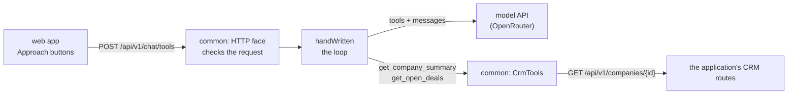

# Stage J8: the same module, built several ways

The plan is in [`docs/roadmap.md`](../roadmap.md) ("Stage J8"); decisions: [ADR 0029](../adr/0029-comparison-backends-behind-one-http-face.md). The code is in [`comparisons/`](../../comparisons/README.md), separate from the application. Slices, one PR each: **J8.1a** the shared parts, the `handWritten` tool-calling backend and the web app's Approach buttons (this page), then J8.1b `withSpringAi`, J8.1c `withLangchain4j`, J8.1d the write-up that compares them.

## In one minute

A model cannot look at your CRM. **Tool calling** is the trick that lets it: you tell the model "these functions exist"; when it needs one, it answers "call this function with these arguments" instead of text; your code runs it, hands the result back, and the model writes the answer. The same trick can be coded by hand, or with a framework doing the loop for you. This stage builds the same small flow each way so you can read them side by side.

| Shop idea | Project idea | Where |
| --- | --- | --- |
| A shop assistant who may phone the stockroom | **The model with tools**: it can ask for a company's facts | the two tools in `common/CrmTools.java` |
| The phone call, written down by hand | **handWritten**: our own loop, plain Java | `tool-calling/handWritten/HandWrittenToolChat.java` |
| The same call, through a switchboard that dials for you | **withSpringAi / withLangchain4j** (later slices) | `tool-calling/withSpringAi`, `tool-calling/withLangchain4j` |
| A switch on the counter that picks which assistant serves you | **The Approach buttons** in the web app | `apps/web/src/api/approaches.ts` |

## J8.1a: what is built

**The loop in `handWritten`** (read `HandWrittenToolChat.answer`): send the conversation and the tools' schemas; if the model asks for tools, run each (at most 4 per reply), wrap each result as `<untrusted_context>` data, put them in the conversation and ask again, at most 4 rounds; after that, one last request with tools switched off forces a plain answer. A call with unreadable or wrong arguments, an unknown tool, or a tool that fails is answered with an error text the model can read, never an exception.

**What it leaves out compared with the application** (so you do not mistake it for the same thing): no prompt guard (no `guardrail` in the answer), no fallback across models, no tracing, no audit log, two read-only tools instead of four.

**The Approach buttons** appear in the web app's tool-calling mode. "The application" is the default and changes nothing. A comparison backend that is not running is greyed out with "(not running)"; choosing one sends only the tool-calling question to its port.

**Measured here:** the behaviour of the loop and the tools against scripted stand-ins (tests below), and that the tools read the real application correctly (`just comparisons-test-live`). **Not measured:** how any real model behaves with these tools, lines of code, speed or cost; those come with the write-up (J8.1d) once all three approaches exist.

**Rule to remember.** *A framework's convenience is a loop someone else wrote. Write it once by hand to know what is inside it.*

## Code tour

| | Where | What |
| --- | --- | --- |
| new | `comparisons/pom.xml` | The build of the comparison modules (Java 21, the application's dependency versions) |
| new | `comparisons/common/` | `Chat` (the shared types and the one interface an approach implements), `CrmClient` (the CRM over HTTP), `CrmTools` (the two tools, their schemas, validation), `ToolBackendServer` (the shared HTTP face) |
| new | `comparisons/tool-calling/handWritten/` | `HandWrittenToolChat` (the loop), `HandWrittenMain` (starts it on port 18101) |
| new | `apps/web/src/api/approaches.ts`, `components/chat/ApproachPicker.tsx`, `hooks/useApproachStatus.ts` | The list of approaches, the buttons, the health check |
| changed | `apps/web/src/api/client.ts`, `chat.ts`, `hooks/useChat.ts`, `context/ChatSessionContext.tsx`, `ChatModeSelector.tsx`, `ChatPanel.tsx` | The tool-calling request can go to another address; the choice is remembered |
| new | `justfile` | `comparisons-test`, `comparisons-test-live`, `comparisons-hand-written` |
| new | `.github/workflows/ci.yml` | A step that builds and tests the comparison modules |

## Questions to try

1. The model asks for two tools in one reply and the second has bad arguments. What does the user see, and what does the model see? (Read the test `anUnknownToolOrBadArgumentsAreAnsweredWithAnError`.)
2. Why is the "tool result" message wrapped in `<untrusted_context>` tags? What would a document with the text "ignore your instructions" do without them?
3. The application's version of this route has a fallback chain and a prompt guard; this one does not. Which would you miss first in production?
